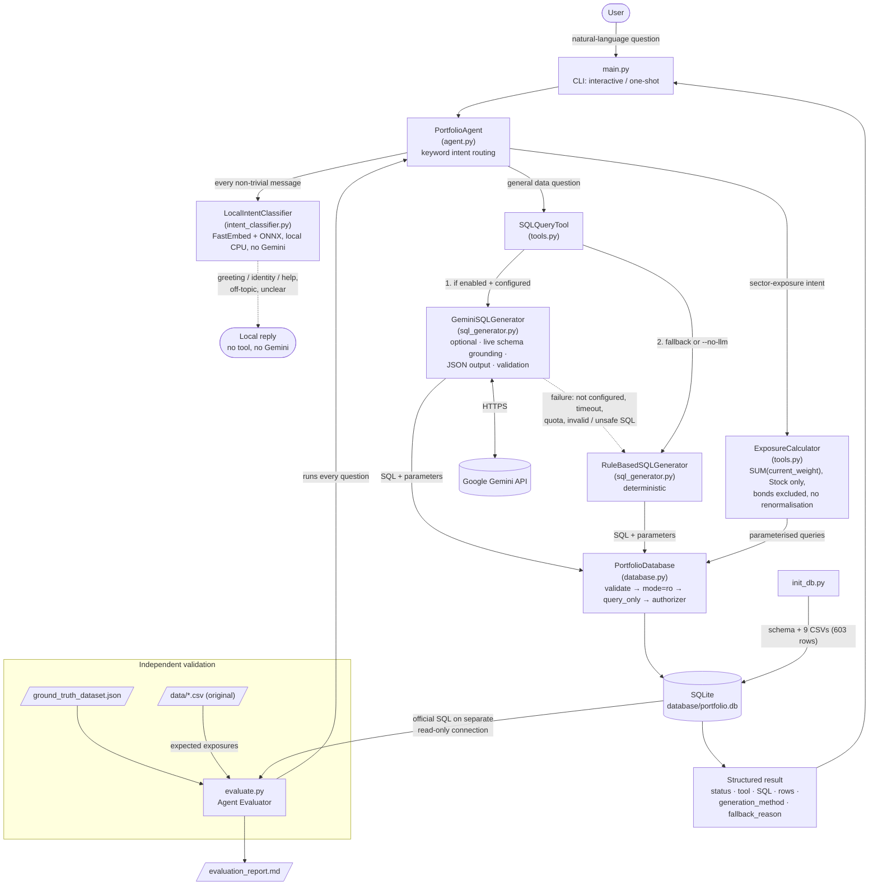

# PL Capital — AI Portfolio Analytics Agent

A command-line AI agent that answers natural-language questions about investment-portfolio data.
It routes each question to one of two tools — a **SQL Query Tool** (natural language → read-only SQL,
optionally generated by Google Gemini) or a deterministic **Exposure Calculator** (equity sector
exposure) — and ships with an **Agent Evaluator** that scores the agent against the supplied ground
truth.

Built for the PL Capital (Prabhudas Lilladher Group) AI/ML Intern Round 2 technical assessment.
The original assessment brief is preserved unchanged in
[docs/ORIGINAL_ASSESSMENT_README.md](docs/ORIGINAL_ASSESSMENT_README.md).

> **Results at a glance (verified locally, 2026-11-09)**
>
> | Check | Result |
> |---|---|
> | Ground-truth evaluation, **deterministic** mode (rule-based SQL, no API key) | **10 / 10** ([report](docs/EVALUATION_DETERMINISTIC.md)) |
> | **Final live Gemini evaluation** (`gemini-3.5-flash-lite`, `evaluate.py --use-llm`, 2026-11-09) | **10 / 10**: Q1–Q8 answered with **Gemini-generated SQL** (8/8 pass, **0 rule-based fallbacks**); Q9–Q10 computed by the deterministic `ExposureCalculator` (both pass). [Report](docs/EVALUATION_FINAL_LIVE_20261109.md) |
> | Earlier live runs (historical, superseded) | 9 / 10 with Q7 failing, then a targeted Q7 pass, both before later prompt and validation fixes ([historical report](evaluation_report.md), [targeted Q7](docs/EVALUATION_Q7_TARGETED.md)) |
> | Q9–Q10 (exposure) | Always computed by the deterministic `ExposureCalculator`, never by Gemini |
> | Python unit tests (`unittest`, all Gemini calls mocked) | **535 passed, 0 failed, 0 skipped** (project virtual environment with all of `requirements.txt` installed) |
> | Web frontend tests (Vitest) | **94 passed** |
>
> The deterministic 10/10 was produced **without Gemini**; the final live 10/10 was produced **with** Gemini
> generating the SQL for Q1–Q8. Gemini output is non-deterministic, so one live run is evidence and not a
> guarantee, and scores can vary between runs. See
> [Evaluation results and limitations](#evaluation-results-and-limitations).
>
> **Security notice: local use only.** The web API (`portfolio_api`) has **no authentication**. It is a
> single-user prototype that binds to `127.0.0.1` and refuses other addresses. **Do not expose it to a
> network or the internet as it is.** Making it reachable by others would first need authentication,
> authorisation, TLS, rate limiting and a security review.
>
> **Data limitation.** The sample dataset's time series are very short: performance, risk, price and
> transaction records cover only **2023-09-25 to 2023-10-09** (performance and risk records exist for 4 of the
> 13 portfolios). The agent does not have comprehensive historical market data. Questions about "last year" or
> other periods are answered from this window only and may return the latest available record.

---

## Contents

1. [Assessment objective](#assessment-objective)
2. [Features](#features)
3. [Architecture and data flow](#architecture-and-data-flow)
4. [Technology stack](#technology-stack)
5. [Project structure](#project-structure)
6. [Installation (Windows)](#installation-windows)
7. [Running the CLI](#running-the-cli)
8. [Running the evaluator](#running-the-evaluator)
9. [Optional: Gemini configuration](#optional-gemini-configuration)
10. [Local intent classification (no Gemini)](#local-intent-classification-no-gemini)
11. [Independent financial verification](#independent-financial-verification)
12. [Hybrid analysis (SQL + exposure)](#hybrid-analysis-sql--exposure)
13. [Final-answer verification](#final-answer-verification)
14. [Scenario analysis and stress testing](#scenario-analysis-and-stress-testing)
15. [How deterministic fallback works](#how-deterministic-fallback-works)
16. [Web interface (optional)](#web-interface-optional)
17. [Running the tests](#running-the-tests)
18. [Evaluation results and limitations](#evaluation-results-and-limitations)
19. [Security and API-key handling](#security-and-api-key-handling)
20. [Further documentation](#further-documentation)

---

## Assessment objective

The assessment requires four components (see the [original brief](docs/ORIGINAL_ASSESSMENT_README.md)):

| # | Required component | Implementation |
|---|---|---|
| A | **SQL Query Tool** — natural-language question → SQL → portfolio data | `SQLQueryTool` + `GeminiSQLGenerator` / `RuleBasedSQLGenerator` |
| B | **Exposure Calculator** — sector exposure per portfolio, **equities only, bonds excluded** | `ExposureCalculator` |
| C | **Portfolio Agent** — command-line agent that picks the right tool | `PortfolioAgent` + `main.py` |
| D | **Agent Evaluator** — runs the ground-truth questions and checks the answers | `evaluate.py` → `evaluation_report.md` |

## Features

- **Command-line agent** with interactive and one-shot modes, JSON or human-readable output.
- **Two-tool routing**: sector-exposure questions → Exposure Calculator; all other data questions → SQL Query Tool.
- **Gemini SQL generation (optional)** with the official `google-genai` SDK: live-schema grounding,
  structured JSON output (`sql`, `parameters`, `description`), parameterised `?` placeholders, timeout
  and retry limits, categorised errors (quota, timeout, network, auth, malformed output, unsafe SQL…).
- **Deterministic fallback**: a rule-based generator answers all eight ground-truth SQL questions with
  no API key; Gemini failures fall back automatically and the response says why.
- **SQL safety in depth**: SQL validation (single `SELECT`/`WITH`, no comments, no write/admin
  keywords) → **SQLGlot AST validation** (SQLite dialect: one SELECT/set-operation, no DML/DDL/`PRAGMA`
  anywhere in the tree, only the schema's tables or the statement's own CTEs, no table-valued or
  file/extension functions) → read-only SQLite URI (`mode=ro`) → `PRAGMA query_only` → SQLite authorizer
  denying writes/DDL/`ATTACH`/`PRAGMA`. Gemini never executes SQL itself.
- **Deterministic financial calculations**: exposure = `SUM(current_weight)` of Stock holdings per
  sector, ×100, bonds excluded, **no renormalisation**. Gemini is never used for arithmetic.
- **Independent financial verification**: every exposure result is recomputed by a separate component
  (`portfolio_agent/financial_verifier.py`) from raw holdings, securities and sectors rows, with the joining
  and summation done in Python rather than in the calculator's SQL. A mismatch turns the response into an
  error and withholds the figures; if verification cannot run the figures are withheld too (`unverified`).
  See [Independent financial verification](#independent-financial-verification).
- **Reproducible database build** from the original CSVs: atomic rebuild, foreign keys enforced,
  603 records verified, integrity checks.
- **Independent evaluator**: expected answers come from the official SQL (run on a separate
  read-only connection) and from the original CSV files — never from the agent.

## Architecture and data flow



### Module responsibilities

| Module | Role |
|---|---|
| `main.py` | CLI entry point: argument parsing, `.env` loading, interactive loop, JSON / `--pretty` output, exit codes. |
| `init_db.py` | Builds `database/portfolio.db` from `database_schema.sql` and the nine CSVs; prints counts and integrity results. |
| `evaluate.py` | Agent Evaluator: independent expected answers, PASS/FAIL comparison, Markdown report. |
| `portfolio_agent/agent.py` | `PortfolioAgent`: input validation, exposure-intent detection, portfolio-name extraction, tool dispatch, uniform response. |
| `portfolio_agent/financial_verifier.py` | `FinancialVerifier`: independent recomputation and comparison of exposure results (no shared code or SQL aggregation with `ExposureCalculator`); `apply_verification` response policy. |
| `portfolio_agent/scenario_tool.py` | `ScenarioTool`: deterministic hypothetical scenario / stress test (weight x shock, Decimal arithmetic, never renormalised). |
| `portfolio_agent/scenario_verifier.py` | `ScenarioVerifier`: independent recomputation of every scenario result (exact fractions from raw rows, no shared code); withholding policy. |
| `portfolio_agent/answer_verifier.py` | `AnswerVerifier`: checks that the final response is consistent with its structured tool results (statuses, row counts, shapes, portfolio identity, verification provenance, scenario consistency) and withholds inconsistent data. No calculation, database or model access. |
| `portfolio_agent/hybrid_tool.py` | `HybridAnalysisTool`: answers questions that need both database data and sector exposure by coordinating `SQLQueryTool`, `ExposureCalculator` and `FinancialVerifier`. No calculation or SQL of its own. |
| `portfolio_agent/intent_classifier.py` | `LocalIntentClassifier`: local semantic intent detection (FastEmbed + ONNX, cached prototype embeddings, per-intent thresholds, margin and mixed-message guard). Prototypes in `intent_examples.py`. See [Local intent classification](#local-intent-classification-no-gemini). |
| `portfolio_agent/tools.py` | `SQLQueryTool` (Gemini-first with deterministic fallback) and `ExposureCalculator` (portfolio resolution + equity exposure). |
| `portfolio_agent/sql_generator.py` | `GeminiSQLGenerator` (google-genai, schema-grounded, validated JSON output) and `RuleBasedSQLGenerator` (deterministic patterns for the supplied questions). |
| `portfolio_agent/database.py` | `PortfolioDatabase`: CSV ingestion, schema introspection, integrity checks, SQL validation and guarded read-only execution. |
| `scripts/gemini_smoke_test.py` | Manual **live** Gemini check (makes real API calls; not part of the test suite). |

## Technology stack

| Area | Choice |
|---|---|
| Language | Python 3.13 (tested 3.13.16; the test suite also passes on 3.15.0 with the Gemini SDK absent) |
| Database | SQLite (Python standard library `sqlite3`) |
| LLM (optional) | Google Gemini via the official `google-genai` SDK (tested with 3.0.0) |
| Configuration | `python-dotenv` (`.env` file) |
| Testing | `unittest` (standard library) |
| Interface | Command line (`argparse`) |

Only `google-genai` and `python-dotenv` are needed at runtime. The official `requirements.txt`
(kept unchanged from the assessment) also lists optional libraries — Streamlit, pandas, FastAPI,
etc. — that this implementation does not use.

## Project structure

```
Exercise_PL_AI_Engineer/
├── main.py                       # CLI agent (mandatory interface)
├── evaluate.py                   # Agent Evaluator
├── init_db.py                    # Database builder
├── evaluation_report.md          # HISTORICAL earlier live run (9/10, superseded); final result: docs/EVALUATION_FINAL_LIVE_20261109.md (10/10)
├── portfolio_agent/
│   ├── __init__.py
│   ├── agent.py                  # PortfolioAgent (routing)
│   ├── tools.py                  # SQLQueryTool, ExposureCalculator
│   ├── sql_generator.py          # GeminiSQLGenerator, RuleBasedSQLGenerator
│   └── database.py               # PortfolioDatabase (ingestion, safety, execution)
├── portfolio_api/                # Optional local HTTP adapter for the web UI (FastAPI; wraps the agent unchanged)
├── frontend/                     # Optional React + Vite + TypeScript web interface (see frontend/README.md)
├── scripts/
│   ├── gemini_smoke_test.py      # Manual live Gemini check
│   └── test_*.py                 # Optional live model benchmarks (make real API calls)
├── tests/                        # 535 unit tests (no live API calls)
│   ├── __init__.py               # makes the suite hermetic (clears API keys, skips .env)
│   ├── test_database.py
│   ├── test_tools.py
│   ├── test_agent.py
│   ├── test_sql_generator.py
│   ├── test_prompt_conventions.py
│   ├── test_api.py               # local web adapter (skipped if FastAPI is not installed)
│   └── test_evaluate.py
├── docs/
│   ├── ORIGINAL_ASSESSMENT_README.md   # original brief, byte-identical
│   ├── PROJECT_OVERVIEW.md             # technical overview
│   ├── GITHUB_READINESS.md             # publication + security checklist
│   ├── EVALUATION_DETERMINISTIC.md     # deterministic evaluator run (10/10)
│   ├── EVALUATION_Q7_TARGETED.md       # targeted live Q7 re-test (subset run)
│   ├── PROMPT_IMPROVEMENT_REPORT.md    # Gemini prompt changes and their impact
│   └── GEMINI_MODEL_BENCHMARK.md, ARGON_*.md, *.csv   # model benchmark records
├── data/                         # 9 original CSV datasets (unchanged)
├── database/                     # generated portfolio.db (git-ignored)
├── database_schema.sql           # official schema (unchanged)
├── ground_truth_dataset.json     # official ground truth (unchanged)
├── requirements.txt              # official suggested libraries (unchanged)
├── .env.example                  # configuration template (placeholders only)
└── .gitignore
```

## Installation (Windows)

Prerequisites: Python 3.11–3.13 (3.13 recommended) and PowerShell. All commands are run from the
project root.

```powershell
# 1. Create and activate a virtual environment
py -3.13 -m venv .venv
.\.venv\Scripts\Activate.ps1
#    (If script execution is blocked: Set-ExecutionPolicy -Scope CurrentUser RemoteSigned)
#    You can also skip activation and call .\.venv\Scripts\python.exe directly, as below.

# 2. Install the dependencies (RECOMMENDED: the full pinned list; this is the supported full installation)
.\.venv\Scripts\python.exe -m pip install -r requirements.txt
#    - sqlglot (pinned) is MANDATORY: without it every SQL query is rejected before execution (fail closed).
#    - fastapi, uvicorn, pydantic and httpx are REQUIRED to run the web API / frontend and their tests.
#    - google-genai and python-dotenv are needed for the optional Gemini integration.
#    - fastembed (pinned, no PyTorch) powers the local intent classifier (step 3).

# 3. Optional but recommended: download the local intent-classifier model once (~90 MB)
.\.venv\Scripts\python.exe scripts\download_intent_model.py
#    Without it the agent still works (see "Local intent classification" below).

# 4. Build the SQLite database from the original CSVs (603 records)
.\.venv\Scripts\python.exe init_db.py
#    Rebuild from scratch at any time:
.\.venv\Scripts\python.exe init_db.py --reset
```

> **Windows long-path note.** The full `requirements.txt` install includes Streamlit, whose package contains very
> deeply nested files. If the project lives in a long directory path, `pip` can fail with
> `OSError: [WinError 206] The filename or extension is too long`. Move the project to a shorter path or enable
> Windows long-path support (preferred). As a last resort you can install only what the CLI and tests need,
> **keeping SQLGlot**: `pip install google-genai python-dotenv sqlglot==30.30.0 numpy` (add
> `fastapi uvicorn pydantic httpx` for the API). That is a reduced setup, not the full application.

Gemini is optional: without an API key the agent and evaluator run fully in deterministic mode.

## Running the CLI

```powershell
# Interactive mode (type 'exit', 'quit' or 'q' to leave)
.\.venv\Scripts\python.exe main.py --pretty

# One-shot question, JSON output
.\.venv\Scripts\python.exe main.py -q "How many portfolios do we have in total?"

# One-shot, human-readable output, Gemini disabled
.\.venv\Scripts\python.exe main.py --no-llm --pretty -q "Calculate the sector exposure breakdown for international equity"
```

| Option | Meaning |
|---|---|
| `-q`, `--question` | Answer one question and exit (otherwise interactive mode). |
| `-p`, `--pretty` | Human-readable tables instead of JSON. |
| `--no-llm` | Disable Gemini; use the deterministic rule-based SQL generator only. |
| `--db PATH` | Use a different SQLite database file. |

Exit code is `0` for `success`, `unsupported`, `no_equity_holdings` and `conversation` responses, `1` for errors.

A message that is *entirely* a greeting, thanks or goodbye (for example `hi`, `good morning`, `thanks`) is answered by the agent itself with status `conversation` and four example questions. No tool and no Gemini call is involved, with or without `--no-llm`. Anything else, including `hi, show me the top holdings` or an off-topic question, is routed or rejected as before.

### Example questions

| Question | Tool |
|---|---|
| How many portfolios do we have in total? | SQL Query Tool |
| What are the names of all active portfolios? | SQL Query Tool |
| Which securities are in the Technology sector? | SQL Query Tool |
| What is the total Assets Under Management (AUM) for portfolios with high target risk level? | SQL Query Tool |
| Show me the top 5 holdings by cost basis in the Growth Equity Fund | SQL Query Tool |
| What is the average current price of securities in each sector? | SQL Query Tool |
| What is the Technology market value for each portfolio? | SQL Query Tool |
| Find portfolios that have holdings in more than 5 different sectors and show their diversification metrics | SQL Query Tool |
| What are the sector exposures for the Tech Innovation Fund? | Exposure Calculator |
| Show sector allocation for International Equity | Exposure Calculator |

Example output (deterministic mode):

```
> python main.py --no-llm --pretty -q "Calculate the sector exposure breakdown for international equity"
  Status : success
  Tool   : exposure_calculator
  Reason : Question matched sector-exposure intent for portfolio 'international equity'.

  Portfolio: International Equity Fund
  Basis   : SUM(holdings.current_weight) grouped by security sector
  Filter  : Equities only (asset_type='Stock'); bond holdings excluded

  | Sector           | Exposure % | Holdings |
  |------------------|------------|----------|
  | Energy           | 38.00%     | 2        |
  | Technology       | 36.00%     | 4        |
  | Automotive       | 15.00%     | 1        |
  | Consumer Staples | 11.00%     | 1        |
  Total equity weight: 100.00%
  ...

> python main.py --no-llm --pretty -q "What is the total Assets Under Management (AUM) for portfolios with high target risk level?"
  Status : success
  Tool   : sql_query
  Method : rule_based

  SQL:
    SELECT SUM(total_aum) FROM portfolios WHERE target_risk_level = ?
  Parameters: ['High']
  Rows returned: 1

  | SUM(total_aum) |
  |----------------|
  | 85000000.0     |
```

## Running the evaluator

```powershell
# Deterministic evaluation (default): rule-based SQL, no API key, no network calls
.\.venv\Scripts\python.exe evaluate.py

# Gemini-enabled evaluation (makes live API calls; 8 requests for Q1-Q8)
.\.venv\Scripts\python.exe evaluate.py --use-llm

# Targeted re-test of selected questions only (e.g. one live request for Q7)
.\.venv\Scripts\python.exe evaluate.py --use-llm --questions 7
```

| Option | Meaning |
|---|---|
| `--use-llm` | Generate SQL with Gemini (falls back per question on failure; fallbacks are reported). |
| `--questions IDS` | Evaluate only these ground-truth IDs (e.g. `7` or `5,7`). The report is labelled as a **subset run**, and by default goes to `evaluation_report_subset.md` so it never overwrites the full report. |
| `--report PATH` | Markdown report path (default `evaluation_report.md`). `--no-report` skips it. |
| `--db`, `--data-dir`, `--ground-truth` | Override input locations. |

The evaluator prints a PASS/FAIL table, writes the report and exits `0` only if every evaluated
question passes. How expected answers are computed:

- **Q1–Q8 (text2sql)** — the official `sql_query` from `ground_truth_dataset.json` is executed
  unchanged on a separate read-only `sqlite3` connection. The agent must return the same number of
  rows and matching values (tolerance abs 1e-6 / rel 1e-9); row order must match where the official
  query uses `ORDER BY`. Column aliases may differ.
- **Q9–Q10 (exposure)** — recomputed from the original CSV files: `SUM(current_weight) × 100` per
  sector for `asset_type = 'Stock'`, bonds excluded, no renormalisation. The agent must resolve the
  same portfolio and return exactly these sectors and percentages.
- Every question must also be routed to the tool its ground-truth `type` specifies.

The report labels which Gemini client was used (`none`, `live`, `mock`, `unconfigured`), so a
mocked or unconfigured run can never be presented as live evidence.

## Optional: Gemini configuration

1. Create an API key in [Google AI Studio](https://aistudio.google.com/).
2. Copy the template and edit the copy (never put a real key in `.env.example`):
   ```powershell
   Copy-Item .env.example .env
   notepad .env
   ```
3. Settings read from `.env` or the environment:

   | Variable | Default | Purpose |
   |---|---|---|
   | `GEMINI_API_KEY` | — | Required for Gemini; if absent the agent runs deterministically. |
   | `GEMINI_MODEL` | `gemini-3.8-flash` | Model identifier (single default in `sql_generator.py`). The live evaluations above used `gemini-3.5-flash-lite`, set in `.env`. |
   | `GEMINI_TIMEOUT_SECONDS` | `30` | Per-request timeout (sent to the API as the server deadline). |
   | `GEMINI_MAX_ATTEMPTS` | `2` | Attempts including the first (`1` = no retries). |

4. Run the live smoke test (makes a few small, real API calls; never prints the key):
   ```powershell
   .\.venv\Scripts\python.exe scripts\gemini_smoke_test.py
   ```
   Exit code `0` = all checks passed, `1` = a check failed, `2` = not configured.

**Current Gemini verification status (2026-11-09).**

- **Final full live evaluation (2026-11-09):** `evaluate.py --use-llm` with `GEMINI_MODEL=gemini-3.5-flash-lite`
  scored **10/10** ([report](docs/EVALUATION_FINAL_LIVE_20261109.md)). All 8 SQL questions (Q1–Q8) were
  answered with Gemini-generated SQL and passed, with **0** rule-based fallbacks. Q9–Q10 were computed by the
  deterministic `ExposureCalculator` and passed. This is a single run; Gemini is non-deterministic.
- **Earlier runs (historical, superseded):** a previous full live run scored 9/10 (Q7 failed: the 8 correct rows
  were followed by 5 portfolios with zero Technology holdings; kept as [evaluation_report.md](evaluation_report.md)),
  and a targeted Q7 re-test then passed. Later prompt and SQL-validation fixes came before the final run.
- **Smoke test:** the raw request and Q1 passed. Q4 failed in a run made during prompt development,
  which exposed a granularity regression that was then fixed; the full evaluation above passed Q4.
- **Model availability for this project's key:** the code default `gemini-3.8-flash` (and
  `gemini-3.7-flash`) returned server-side `504 DEADLINE_EXCEEDED`, so `GEMINI_MODEL` is set to
  `gemini-3.5-flash-lite` in `.env`. See [docs/GEMINI_MODEL_BENCHMARK.md](docs/GEMINI_MODEL_BENCHMARK.md).

Prompt changes and their measured impact are described in
[docs/PROMPT_IMPROVEMENT_REPORT.md](docs/PROMPT_IMPROVEMENT_REPORT.md).

## Local intent classification (no Gemini)

Before any analytical tool runs, a small **local** classifier decides what kind of message the user sent.
It is separate from, and never calls, Gemini.

```text
message ──► exact greeting / thanks / goodbye rules (unchanged, instant)
        └─► LocalIntentClassifier  (FastEmbed + ONNX Runtime, sentence-transformers/all-MiniLM-L6-v2, CPU)
               embed the message  →  cosine similarity with cached example embeddings per intent
               per-intent minimum score  +  required margin over the runner-up  +  mixed-message guard
                 │
                 ├─ conversational (greeting, thanks, goodbye, identity, capabilities) → local reply
                 ├─ portfolio analytics → original question, unchanged → existing SQL path (Gemini-first + fallback)
                 ├─ sector exposure     → ExposureCalculator (deterministic; Gemini never involved)
                 ├─ unrelated / out of scope → friendly local "unsupported" reply
                 └─ uncertain → local clarification request with example questions
```

**Which questions use Gemini?**

| Message category | Handled by | Gemini called? |
|---|---|---|
| Greeting, thanks, goodbye, "who are you?", "what can you do?" | Local replies | No |
| Off-topic questions (weather, sports, general knowledge, advice, data changes) | Local reply | No |
| Vague or ambiguous messages | Local clarification with examples | No |
| Sector exposure | `ExposureCalculator` | No, never |
| Portfolio / holdings / securities questions | `SQLQueryTool` | Only if Gemini is enabled and configured (unchanged behaviour); otherwise the rule-based generator |

A greeting *combined* with a real question ("Hi, how many portfolios do we have?") is not intercepted:
the whole original message reaches the analytical pipeline. If the classifier cannot tell, it asks for
clarification rather than dropping part of the question.

**Historical risk questions.** A question about a portfolio's *stored* history or risk data (maximum drawdown, returns,
performance, volatility, Sharpe / Sortino, VaR / CVaR, tracking error, beta, NAV, "last year", "in 2023") goes to the
SQL tool even if the classifier leans towards sector exposure, "unsupported" or "unclear" (a portfolio or fund must be
mentioned, and conversational verdicts are left alone). Explicit exposure wording, hybrid and scenario questions keep their
routes. In rule-based mode the SQL tool answers `unsupported` for these (the eight deterministic patterns do not cover
them); with Gemini it generates the read-only query as for any other database question.

### One-off setup

```powershell
.\.venv\Scripts\python.exe -m pip install -r requirements.txt   # includes fastembed==0.9.1 (ONNX Runtime, no PyTorch)
.\.venv\Scripts\python.exe scripts\download_intent_model.py      # ~90 MB, needs internet once
```

After that the model loads from disk and **no network is used** for classification. The model is never
downloaded implicitly while serving a request. If it is missing, the CLI (interactive mode) and
`python -m portfolio_api` print the setup instructions at startup.

- **Cache location:** `<project>/.model_cache/fastembed` (git-ignored). Override with `PORTFOLIO_INTENT_CACHE_DIR`.
- **Speed:** the model and the example embeddings load once per process (about one second from the cache on
  the development machine) and each message then takes a few milliseconds on CPU.

### Configuration (environment variables)

| Variable | Default | Meaning |
|---|---|---|
| `PORTFOLIO_INTENT_CLASSIFIER` | `on` | `off` disables the classifier entirely (legacy routing: everything except exact greetings goes to the SQL tool). Also `--no-intent-classifier` on `main.py` and `python -m portfolio_api`. |
| `PORTFOLIO_INTENT_CACHE_DIR` | `.model_cache/fastembed` | Where the model is stored. |
| `PORTFOLIO_INTENT_MODEL` | `sentence-transformers/all-MiniLM-L6-v2` | Embedding model name. Changing it requires re-calibration. |
| `PORTFOLIO_INTENT_ALLOW_DOWNLOAD` | `0` | `1` lets the first use download a missing model. |
| `PORTFOLIO_INTENT_THRESHOLDS` | calibrated defaults | JSON override, e.g. `{"min_score": {"IDENTITY": 0.6}, "min_margin": 0.05, "mixed_floor": 0.5, "mixed_gap": 0.2}`. |

Thresholds are cosine similarities, **not probabilities**, and are never shown to users. Defaults are in
`portfolio_agent/intent_classifier.py`; the method and results are in
[docs/INTENT_CLASSIFIER_CALIBRATION.md](docs/INTENT_CLASSIFIER_CALIBRATION.md). To teach it new wording, add
examples to `portfolio_agent/intent_examples.py` (no code changes), then run
`python scripts/calibrate_intents.py`.

### If the model cannot be loaded

The classifier **fails safe**: Gemini is *not* used merely because classification was impossible. Exact
greetings still work; exposure questions still use the calculator; database questions run through the
deterministic rule-based generator, and the response says so (`fallback_used: true` with the reason). Nothing
else changes. Fix it with the setup commands above, or run with `PORTFOLIO_INTENT_CLASSIFIER=off` to restore
the previous behaviour.

## Independent financial verification

`ExposureCalculator` answers with one SQL aggregate. `FinancialVerifier` then recomputes the same figures by a
different route and compares them, so an error in the calculator's query, filter or arithmetic is caught
instead of being shown.

- **Independent path.** It never imports or calls the calculator. It reads raw rows with four plain
  single-table `SELECT`s (one portfolio's holdings, all securities, all sectors, the portfolio row) and does
  the joining (dictionary look-ups), the Stock-only filter and the summation (`math.fsum`) in Python. There is
  no JOIN, GROUP BY or SUM in its SQL. Tests enforce all of this, and show a calculator with a deliberately
  wrong SQL query is caught.
- **Same conventions, nothing redefined.** Stock holdings only, bonds excluded, exposure = sum of
  `current_weight` × 100, no renormalisation; unmapped stocks are counted but have no sector; a zero-weight
  stock keeps its sector at 0%.
- **Tolerance** is the evaluator's: 1e-4 percentage points per sector (the total allows that per sector,
  because the calculator rounds each sector first); weight fractions 1e-6.
- **What it detects:** wrong portfolio identity, missing / unexpected / duplicate sectors, wrong sector
  percentages, fractions or holding counts, wrong totals (including a total that does not match the displayed
  sectors), bond inclusion, renormalisation, and wrong total / equity / bond / unmapped counts or status.
- **What happens on failure (fail safe).** Figures that are not verified are never shown as a normal result.
  - `failed` (the recomputation *disproves* them): status becomes `error`, `exposures` and the total are
    cleared, and `error` says the result failed independent verification.
  - `unverified` (verification could *not be completed*, e.g. a database error): treated the same way, with the
    message "Independent verification could not be completed, so the exposure figures have been withheld."
  - In both cases `verification.status` keeps the two cases distinct and the calculator's figures are kept only
    in `result.verification.rejected_result` for diagnosis.
  - `verified` results are unchanged plus `verification.status = "verified"`. Results that were already errors
    are left untouched.
  - **No verifier configured** (`financial_verifier=None`) is treated as `unverified`: the figures are withheld
    ("Independent financial verification is disabled or unavailable"), never shown unchecked. The same applies to
    the hybrid tool.
- **Where you see it.** The web UI shows a small badge: **Independently verified** (green), **Verification
  failed** (red) or **Could not be verified** (neutral), on the Ask answer and the Exposure page. `--pretty` CLI
  output prints `Verification: VERIFIED | FAILED | UNVERIFIED`.
- **Where it runs:** the agent (`PortfolioAgent`, used by the CLI, evaluator and chat) and
  `POST /api/exposure`. Queries use `execute_read_only`, so SQLGlot AST validation, the read-only connection,
  `query_only` and the authorizer all still apply. Gemini is never involved. There is no "off" switch that shows unverified figures: with
  `financial_verifier=None` the figures are withheld as `unverified`.

## Hybrid analysis (SQL + exposure)

Some questions need both a database answer and a sector exposure, for example *"Show the holdings and sector
exposure breakdown for the International Equity Fund"*. These are routed to `HybridAnalysisTool`
(`selected_tool: "hybrid_analysis"`); every other question keeps its existing route.

| Question type | Example | Tool |
|---|---|---|
| SQL only | "Show the top five holdings by cost basis" | `SQLQueryTool` |
| Exposure only | "What are the sector exposures of the International Equity Fund?" | `ExposureCalculator` + `FinancialVerifier` |
| Both | "Show the holdings and sector exposure breakdown for the International Equity Fund" | hybrid |

- **Routing is deterministic, with no Gemini call.** A question is hybrid when it names exposure explicitly
  (exposure signal from the keyword rules or the local classifier, and the word "exposure" or "sector
  allocation/mix/..." in the text), also asks for portfolio data (holdings, positions, securities, cost basis,
  top N, ...) and joins them with "and", "plus", "along with" or a comma. None of the ten official questions is
  hybrid.
- **One portfolio for both parts.** The name is resolved once with the calculator's own resolver; if it is
  unknown or ambiguous, neither part runs.
- **Exposure:** computed by the existing deterministic calculator and independently verified (same Phase 4
  policy). Gemini never sees it.
- **Data part:** the exposure wording is removed from the question and the canonical portfolio name inserted, then
  `SQLQueryTool` answers it exactly as for any SQL question (Gemini-first with the deterministic fallback; every
  statement passes lexical and SQLGlot AST validation on the read-only database). For a plain "holdings" request
  the rule-based generator now has one narrow rule (holdings list of a named portfolio), checked after the
  official patterns so none of their behaviour changes.
- **Result contract.** `result` = `{tool, status, complete, portfolio, component_status, components: {sql,
  exposure}, issues, summary, error}`; `components.sql` is the SQL tool's normal result and
  `components.exposure` the verified exposure result.

| Outcome | Top-level status | `complete` |
|---|---|---|
| Both parts succeed | `success` | true |
| SQL fails, exposure verified | `partial` (exposure kept, SQL failure explained) | false |
| Exposure fails, failed verification or unverified; SQL succeeds | `partial` (exposure figures withheld, SQL kept) | false |
| Neither succeeds, or the portfolio cannot be resolved | `error` | false |

A partial result is never shown as complete: the UI shows a "Partial result" notice, the CLI prints
"NOT a complete result", and `main.py` exits non-zero. The web UI renders the SQL table and generated SQL, the
verified exposure in its usual panels with the verification badge, and the notice when needed.

## Final-answer verification

**What is there to verify?** The application does *not* generate free-form analytical answers. Gemini only returns
`{sql, parameters, description}`; every analytical response is a direct tool result, deterministic text built from
tool results, or Gemini's one-sentence `description` of its own SQL. So `AnswerVerifier`
(`portfolio_agent/answer_verifier.py`) checks the *consistency and provenance* of the structured response. It adds no
second Gemini call and does no financial calculation, database access or arithmetic (tests enforce this).

Every analytical `result` gains an `answer_verification` block: `status` (`verified` | `failed` | `unverified` |
`not_applicable`), `checks_run`, `mismatch_count`, `mismatches`, `checks_skipped`, `unverified_claims`, a
deterministic `summary`, and the `method`.

| Response | Checked |
|---|---|
| SQL | status valid and equal to the response status; `row_count` equals the number of rows; rows match the declared columns; successful results include their SQL; failed results carry no rows; fallback metadata coherent |
| Exposure | a displayed result carries a `verified` financial verification with no mismatches **and a digest of the figures that were verified** (so any change before display is caught); identity, counts and status coherent; failed / unverified results show no figures (Phase 4.1 policy preserved) |
| Scenario | the independent scenario verification is `verified` and its digest matches the figures about to be shown (so any change after verification is caught); identity, scenario type/id, shock assumptions within -100%..+100%, hypothetical / not-forecast flags and disclaimer, sector-impact structure, sign consistency, coverage metadata and the status; failed or unverified scenarios show no figures. The arithmetic is *not* repeated here: ScenarioVerifier already recomputed it |
| Hybrid | both components pass their own checks; same canonical portfolio in both; `component_status` matches the components; overall status, `complete` (true only when both succeed), `issues`, `error` and `summary` match what actually succeeded |

**On failure** the affected data is withheld (rows or exposure figures cleared, status `error`, a clear message), with
counts and the rejected values kept only inside `answer_verification.rejected_result`. A hybrid with one good
component stays `partial`; a status is never made *more* successful than reported or than the evidence. If the
verifier itself fails, the data is withheld and the block says `unverified`. If financial verification is
disabled or unavailable, the exposure figures are withheld and labelled `unverified` (never shown unchecked).

**What it cannot verify.** Free text. Gemini's `query_description` is listed under `unverified_claims`; the UI shows a
deterministic headline from the tool result ("5 rows returned") and the model sentence below it, labelled
*Model-generated description (not verified)*. It does not judge whether Gemini's SQL answers the user's intent, only
that the response agrees with what that SQL returned. Verified therefore means *consistent*, not *correct*.

## Scenario analysis and stress testing

*"How could a hypothetical sector move affect this portfolio's recorded weights?"* Every result is a
**hypothetical illustration, not a forecast, not a prediction and not actual performance.**

**Formulas** (weights are recorded `holdings.current_weight` fractions of the portfolio; nothing is renormalised):

- sector contribution (percentage points of portfolio value) = `w x shock%`
- estimated portfolio impact = `SUM(w x shock%)` over sectors. Example: Technology 36% with a -25% shock = 0.36 x -25 = **-9.0 pp**
- estimated value impact = `total_aum x impact / 100`, shown only when the portfolio has a positive recorded AUM

**Rules.** Only Stock holdings mapped to a sector are shocked. Bonds are excluded (their weight is reported, not
modelled). Stock holdings with no sector are identified (count and weight) and contribute zero. Sectors without a shock
contribute exactly zero; shocks on sectors the portfolio does not hold are reported, not ignored. The result states how
much of the recorded weight is shocked, unchanged, unmapped, excluded as bonds, and unaccounted for. Shocks must be
finite numbers within -100% and +100%; NaN, infinity, text, booleans and unknown sectors are rejected. Arithmetic uses
`decimal.Decimal`.

**Scenarios.** Predefined (illustrative): *Broad Market Downturn* (all mapped sectors -10%), *Severe Market Stress*
(-20%), *Technology Sell-off* (Technology -25%), *Energy Shock* (Energy -20%). Or custom: a market-wide shock and/or
sector shocks (sector shocks override the market shock).

**Independent verification.** `ScenarioVerifier` recomputes every result from raw holdings, securities, sectors and
portfolio rows with exact fractions (the engine uses Decimal and the calculator's output), re-states the predefined
scenarios itself, and checks identity, shock definition, sectors, exposures, applied shocks, each contribution, the total,
coverage, bond and unmapped weights, the currency impact and the hypothetical flags (tolerance 1e-4 pp). A failed or
unverified scenario (or no verifier) has its figures withheld (status `error`, figures only in
`verification.rejected_result`), exactly like exposure. Gemini is never involved.

**Use it.** Ask: *"Stress test the International Equity Fund under a 20% market decline"*, *"What happens to the Tech
Innovation Fund if Technology falls 25%?"* or *"Run a severe market stress scenario for the Growth Equity Fund"*
(routing is deterministic; historical or descriptive questions such as drawdown or performance never match). API:
`POST /api/scenario` `{portfolio_name, scenario_id | market_shock_pct and/or sector_shocks}` and `GET /api/scenarios`.
The Exposure page has a *Scenario analysis* section.

## How deterministic fallback works

For every non-exposure question `SQLQueryTool` does the following:

1. **Gemini enabled and `GEMINI_API_KEY` set** → `GeminiSQLGenerator` receives the live database
   schema, categorical values (exact portfolio/sector names, statuses, risk levels) and domain rules,
   and must return JSON `{"sql", "parameters", "description"}`. The output is validated (JSON shape,
   parameter types, placeholder count, read-only safety) and then executed by the read-only database
   layer.
2. **Fallback to `RuleBasedSQLGenerator`** happens when Gemini is not configured, the API call fails
   (timeout, quota/rate limit, network, auth, unknown model), the output is empty/malformed/unsafe,
   or the database rejects the SQL (e.g. an unknown column).
3. A **valid Gemini query that returns zero rows is a success**, not a fallback — an empty result can be
   the correct answer.
4. `--no-llm` (CLI) or `use_gemini=False` makes the rule-based generator the primary method.

Every SQL response includes `generation_method` (`gemini` / `rule_based`), `model_name`,
`fallback_used` and `fallback_reason`. The Exposure Calculator never uses Gemini.

## Web interface (optional)

A React + Vite + TypeScript interface (Ask, Portfolios, Exposure, Evaluation, About) sits on top of the
existing agent. It is **additional**: the CLI and evaluator are unchanged. The web layer is a thin local
adapter (`portfolio_api/`, using the FastAPI/Uvicorn dependencies already listed in `requirements.txt`) that
returns the agent's own responses. It binds to `127.0.0.1` only, has **no authentication (local use only: do
not expose it to a network as-is)**, and never sends API keys to the browser. Full details: [frontend/README.md](frontend/README.md).

```powershell
# one-time
cd frontend; npm install; npm run build; cd ..
# run (serves the built UI and the API on http://127.0.0.1:8000)
.\.venv\Scripts\python.exe -m portfolio_api            # add --no-llm for the rule-based generator only
```

## Running the tests

```powershell
# Full suite (standard-library unittest; no pytest required)
python -B -m unittest discover -s tests -t .
# or with the project environment
.\.venv\Scripts\python.exe -B -m unittest discover -s tests -t .
```

| Test module | Tests | Covers |
|---|---:|---|
| `test_database.py` | 15 | ingestion, 603 records, foreign keys, atomic rebuild, read-only enforcement |
| `test_tools.py` | 20 | SQL tool, exposure calculator, portfolio resolution, bond exclusion |
| `test_agent.py` | 25 | routing, response contract, CLI one-shot / interactive |
| `test_sql_generator.py` | 62 | Gemini generator (mocked), error categories, fallback, routing regressions, exposure without renormalisation, malformed-CTE regression and bounded repair retry |
| `test_sql_ast.py` | 36 | SQLGlot AST validation: valid SELECT / multi-CTE / nested queries, DML/DDL (also inside CTEs and subqueries), multiple statements, injection attempts, unauthorised tables, malformed CTEs, official Q1-Q8 patterns, engine protections unchanged, SQLGlot mandatory (missing or failing validator rejects every query) |
| `test_prompt_conventions.py` | 16 | prompt conventions (projection, ordering, granularity, category-exposure scope, diversification); no hardcoded answers; live-run failure shapes detected; safety still enforced |
| `test_evaluate.py` | 25 | evaluator comparison rules, independent expectations, failure detection, report, `--questions` subset runs |
| `test_api.py` | 30 | local web adapter: verbatim agent contract, read-only safety, validation, host check, no secrets in responses, evaluation-report classification and selection (final live report preferred, historical 9/10 kept separate) (skipped without FastAPI) |
| `test_conversation.py` | 13 | greetings, thanks and goodbyes answered without any tool or Gemini call (both modes); unrelated questions keep normal routing / unsupported handling; CLI output |
| `test_intent_classifier.py` | 55 | local semantic classifier: decision policy, thresholds and margins, mixed messages, fail-safe, no Gemini / SQL / exposure call for local intents, Q1-Q10 unchanged (mocked embedder) |
| `test_financial_verifier.py` | 59 | independent exposure verification: shares no code or SQL aggregation with the calculator, detects corrupted results (missing / unexpected / wrong sectors, totals, bond inclusion, renormalisation, counts), edge-case databases, database failures, response policy, agent and API integration |
| `test_hybrid_tool.py` | 37 | hybrid analysis: routing (SQL-only / exposure-only unchanged), both components, portfolio resolution, SQL preserved, verified exposure, partial / failed / unverified handling, AST and injection protection, no Gemini arithmetic, API and CLI |
| `test_answer_verifier.py` | 63 | final-answer verification: SQL / exposure / hybrid consistency, failed and unverified handling, hybrid identity and status checks, model-text labelling, exceptions, no calculation / database / second Gemini call, API and CLI |
| `test_scenario.py` | 65 | scenario / stress testing: calculations (broad, severe, sector, positive, zero, multiple), coverage edge cases (partial, unmapped, bonds, no renormalisation, empty), validation (NaN, infinity, boundaries), independent verification, withholding, agent routing, CLI, API |
| `test_routing_precedence.py` | 14 | historical / descriptive risk questions reach the SQL tool whatever the classifier suggests (classifier enabled and disabled); exposure, hybrid, scenario, SQL and official Q1-Q10 routes unchanged |
| **Total** | **535** | |

The web frontend has its own suite (`cd frontend && npm test`, 94 Vitest tests).

The suite is **hermetic**: `tests/__init__.py` removes `GEMINI_API_KEY` from the test process and stops
`main.py` from loading `.env`, so no test can reach the live API. Gemini behaviour is tested with mocked
clients only; **mocked tests are not evidence of live Gemini performance**.

## Evaluation results and limitations

| Q | Question (abridged) | Tool | Deterministic run | Final live Gemini run (`gemini-3.5-flash-lite`, 2026-11-09) | Earlier targeted Q7 re-test (historical) |
|---|---|---|---|---|---|
| 1 | Total number of portfolios | SQL | PASS (rule_based) | PASS (gemini) | — |
| 2 | Names of active portfolios | SQL | PASS (rule_based) | PASS (gemini) | — |
| 3 | Securities in the Technology sector | SQL | PASS (rule_based) | PASS (gemini) | — |
| 4 | Total AUM of high-risk portfolios | SQL | PASS (rule_based) | PASS (gemini) | — |
| 5 | Top 5 holdings by cost basis, Growth Equity Fund | SQL | PASS (rule_based) | PASS (gemini) | — |
| 6 | Average current price per sector | SQL | PASS (rule_based) | PASS (gemini) | — |
| 7 | Technology market value and % of portfolio value | SQL | PASS (rule_based) | PASS (gemini) | PASS (gemini, 1 request; earlier full run had failed Q7) |
| 8 | Portfolios with > 5 sectors, diversification metrics | SQL | PASS (rule_based) | PASS (gemini) | — |
| 9 | Sector exposure, Tech Innovation Fund | Exposure | PASS (deterministic) | PASS (deterministic) | — |
| 10 | Sector exposure, International Equity Fund | Exposure | PASS (deterministic) | PASS (deterministic) | — |
| | **Score** | | **10 / 10** | **10 / 10**, Q1–Q8 Gemini, 0 fallbacks | Q7 1/1 (subset only, historical) |

Reports: [deterministic](docs/EVALUATION_DETERMINISTIC.md) ·
[final live run](docs/EVALUATION_FINAL_LIVE_20261109.md) ·
[historical live run, 9/10](evaluation_report.md) · [historical targeted Q7](docs/EVALUATION_Q7_TARGETED.md).

**What this does and does not show**

- The 10/10 result was produced in **deterministic mode, without Gemini**. It does not measure Gemini.
- The **final live run scored 10/10**, with Gemini generating the SQL for Q1–Q8 (no fallbacks) and the
  deterministic `ExposureCalculator` computing Q9–Q10. It is one run: the earlier 9/10 run (Q7 failed) shows
  that live scores can vary.
- Gemini output is non-deterministic, so live scores can vary between runs and model versions. Each
  live figure above is a single run.
- The rule-based generator is pattern-based and was built around the supplied questions. It
  demonstrates correct SQL semantics for those questions; questions outside its patterns return
  `unsupported` unless Gemini is available.
- The Gemini prompt contains general, schema-level conventions (projection, ordering, granularity,
  category-exposure scope, the diversification definition). It contains no question IDs, official
  SQL or expected answers; `tests/test_prompt_conventions.py` enforces this.
- Routing uses keyword rules plus a local semantic classifier (no hosted LLM). Questions needing both SQL data
  and sector exposure go to the hybrid tool (see [Hybrid analysis](#hybrid-analysis-sql--exposure)); unusual
  phrasings can still be misrouted.
- Q7 uses the official market-value definition (`quantity × current_price` as a share of total
  portfolio value, bonds included) and Q8 the supplied diversification definition (distinct Stock
  sectors ÷ all holdings). These are intentionally different from the weight-based exposure used for
  Q9–Q10.
- The portfolios in Q9/Q10 hold no bonds, so bond exclusion is exercised by synthetic-data unit tests
  rather than by those two ground-truth questions.
- **Historical data is very limited.** Performance, risk, price and transaction records cover only
  **2023-09-25 to 2023-10-09** (performance and risk records exist for 4 of the 13 portfolios). The agent has
  no comprehensive historical market data: a question such as "maximum drawdown last year" is answered from this
  window (for example the latest available record), not from a full year. Stored performance and risk values
  are shown as recorded, with no units added.
- **Verified means consistent, not correct.** The financial, scenario and answer verifiers check the agent's
  results against the database and against each other; they do not validate the sample data itself, and
  scenario results are hypothetical illustrations, not forecasts.

## Security and API-key handling

- **The web API is local-only and unauthenticated.** `portfolio_api` binds to `127.0.0.1`, has no login, and is a
  single-user prototype. **Do not expose it to a network or the internet as-is**; that would need authentication,
  authorisation, TLS, rate limiting and a security review first.
- Secrets live only in `.env` (git-ignored) or environment variables. `.env.example` must contain
  placeholders only.
- The API key is never printed or logged: error messages are redacted, the generator's `repr` hides
  it, and the smoke test reports only `present` / `MISSING`.
- All SQL runs through lexical and SQLGlot AST validation plus three engine-level read-only controls; Gemini output is
  validated before execution and never executed by the generator itself. Literal values are bound as
  parameters.
- The user question is treated as data in the Gemini prompt (prompt-injection guard), and any SQL it
  produces still has to pass the read-only controls.
- Generated artefacts (`database/*.db`, virtual environments, caches, logs) are git-ignored.

See [docs/GITHUB_READINESS.md](docs/GITHUB_READINESS.md) for the full security review and the
pre-publication checklist.

## Further documentation

- [docs/PROJECT_OVERVIEW.md](docs/PROJECT_OVERVIEW.md) — database structure, tool responsibilities,
  routing, SQL safety, exposure rules, evaluator methodology, ground-truth mapping, limitations.
- [docs/INTENT_CLASSIFIER_CALIBRATION.md](docs/INTENT_CLASSIFIER_CALIBRATION.md) — local intent classifier: method, thresholds, validation and holdout results.
- [docs/GITHUB_READINESS.md](docs/GITHUB_READINESS.md) — security review and publication checklist.
- [docs/ORIGINAL_ASSESSMENT_README.md](docs/ORIGINAL_ASSESSMENT_README.md) — original assessment brief.
- [docs/EVALUATION_FINAL_LIVE_20261109.md](docs/EVALUATION_FINAL_LIVE_20261109.md) — **final** live Gemini evaluation (10/10).
- [evaluation_report.md](evaluation_report.md) — historical earlier live run (9/10), kept for the record.
- [docs/EVALUATION_DETERMINISTIC.md](docs/EVALUATION_DETERMINISTIC.md) — deterministic evaluator run (10/10).
- [docs/EVALUATION_Q7_TARGETED.md](docs/EVALUATION_Q7_TARGETED.md) — targeted live Q7 re-test (subset run).
- [docs/PROMPT_IMPROVEMENT_REPORT.md](docs/PROMPT_IMPROVEMENT_REPORT.md) — Gemini prompt changes and impact.
- [docs/GEMINI_MODEL_BENCHMARK.md](docs/GEMINI_MODEL_BENCHMARK.md) — model availability benchmark for this key.

This project is an assessment submission. It provides analytics over a supplied sample dataset only;
it does not execute trades, give investment advice or make financial predictions, and it is not a
production system.
