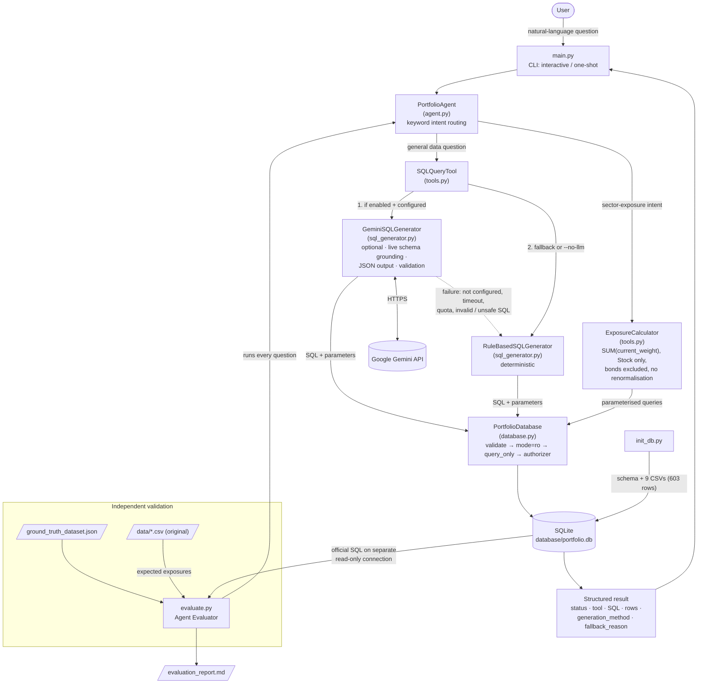

# PL Capital — AI Portfolio Analytics Agent

A command-line AI agent that answers natural-language questions about investment-portfolio data.
It routes each question to one of two tools — a **SQL Query Tool** (natural language → read-only SQL,
optionally generated by Google Gemini) or a deterministic **Exposure Calculator** (equity sector
exposure) — and ships with an **Agent Evaluator** that scores the agent against the supplied ground
truth.

Built for the PL Capital (Prabhudas Lilladher Group) AI/ML Intern Round 2 technical assessment.
The original assessment brief is preserved unchanged in
[docs/ORIGINAL_ASSESSMENT_README.md](docs/ORIGINAL_ASSESSMENT_README.md).

> **Results at a glance (verified locally, 2026-11-09)**
>
> | Check | Result |
> |---|---|
> | Ground-truth evaluation, **deterministic** mode (rule-based SQL, no API key) | **10 / 10** ([report](docs/EVALUATION_DETERMINISTIC.md)) |
> | Latest **full live Gemini** evaluation (`gemini-3.5-flash-lite`, `evaluate.py --use-llm`) | **9 / 10**: Q7 failed; 8/8 SQL questions used Gemini, **0 rule-based fallbacks** ([report](evaluation_report.md)) |
> | Targeted live re-test of **Q7 only**, after a prompt fix (1 request) | **PASS** ([report](docs/EVALUATION_Q7_TARGETED.md)), reported separately and **not** a full-run result |
> | Q9–Q10 (exposure) | Always computed by the deterministic `ExposureCalculator`, never by Gemini |
> | Unit tests (`unittest`, all Gemini calls mocked) | **149 passed** |
>
> The 10/10 score was produced **without Gemini**. The latest *complete* live Gemini run scored
> **9/10**. Q7 passed in a later targeted run, but no full live run has been repeated since, so a
> live 10/10 has **not** been demonstrated. Gemini output is non-deterministic and scores can vary
> between runs. See [Evaluation results and limitations](#evaluation-results-and-limitations).

---

## Contents

1. [Assessment objective](#assessment-objective)
2. [Features](#features)
3. [Architecture and data flow](#architecture-and-data-flow)
4. [Technology stack](#technology-stack)
5. [Project structure](#project-structure)
6. [Installation (Windows)](#installation-windows)
7. [Running the CLI](#running-the-cli)
8. [Running the evaluator](#running-the-evaluator)
9. [Optional: Gemini configuration](#optional-gemini-configuration)
10. [How deterministic fallback works](#how-deterministic-fallback-works)
11. [Running the tests](#running-the-tests)
12. [Evaluation results and limitations](#evaluation-results-and-limitations)
13. [Security and API-key handling](#security-and-api-key-handling)
14. [Further documentation](#further-documentation)

---

## Assessment objective

The assessment requires four components (see the [original brief](docs/ORIGINAL_ASSESSMENT_README.md)):

| # | Required component | Implementation |
|---|---|---|
| A | **SQL Query Tool** — natural-language question → SQL → portfolio data | `SQLQueryTool` + `GeminiSQLGenerator` / `RuleBasedSQLGenerator` |
| B | **Exposure Calculator** — sector exposure per portfolio, **equities only, bonds excluded** | `ExposureCalculator` |
| C | **Portfolio Agent** — command-line agent that picks the right tool | `PortfolioAgent` + `main.py` |
| D | **Agent Evaluator** — runs the ground-truth questions and checks the answers | `evaluate.py` → `evaluation_report.md` |

## Features

- **Command-line agent** with interactive and one-shot modes, JSON or human-readable output.
- **Two-tool routing**: sector-exposure questions → Exposure Calculator; all other data questions → SQL Query Tool.
- **Gemini SQL generation (optional)** with the official `google-genai` SDK: live-schema grounding,
  structured JSON output (`sql`, `parameters`, `description`), parameterised `?` placeholders, timeout
  and retry limits, categorised errors (quota, timeout, network, auth, malformed output, unsafe SQL…).
- **Deterministic fallback**: a rule-based generator answers all eight ground-truth SQL questions with
  no API key; Gemini failures fall back automatically and the response says why.
- **SQL safety in depth**: SQL validation (single `SELECT`/`WITH`, no comments, no write/admin
  keywords) → read-only SQLite URI (`mode=ro`) → `PRAGMA query_only` → SQLite authorizer denying
  writes/DDL/`ATTACH`/`PRAGMA`. Gemini never executes SQL itself.
- **Deterministic financial calculations**: exposure = `SUM(current_weight)` of Stock holdings per
  sector, ×100, bonds excluded, **no renormalisation**. Gemini is never used for arithmetic.
- **Reproducible database build** from the original CSVs: atomic rebuild, foreign keys enforced,
  603 records verified, integrity checks.
- **Independent evaluator**: expected answers come from the official SQL (run on a separate
  read-only connection) and from the original CSV files — never from the agent.

## Architecture and data flow



### Module responsibilities

| Module | Role |
|---|---|
| `main.py` | CLI entry point: argument parsing, `.env` loading, interactive loop, JSON / `--pretty` output, exit codes. |
| `init_db.py` | Builds `database/portfolio.db` from `database_schema.sql` and the nine CSVs; prints counts and integrity results. |
| `evaluate.py` | Agent Evaluator: independent expected answers, PASS/FAIL comparison, Markdown report. |
| `portfolio_agent/agent.py` | `PortfolioAgent`: input validation, exposure-intent detection, portfolio-name extraction, tool dispatch, uniform response. |
| `portfolio_agent/tools.py` | `SQLQueryTool` (Gemini-first with deterministic fallback) and `ExposureCalculator` (portfolio resolution + equity exposure). |
| `portfolio_agent/sql_generator.py` | `GeminiSQLGenerator` (google-genai, schema-grounded, validated JSON output) and `RuleBasedSQLGenerator` (deterministic patterns for the supplied questions). |
| `portfolio_agent/database.py` | `PortfolioDatabase`: CSV ingestion, schema introspection, integrity checks, SQL validation and guarded read-only execution. |
| `scripts/gemini_smoke_test.py` | Manual **live** Gemini check (makes real API calls; not part of the test suite). |

## Technology stack

| Area | Choice |
|---|---|
| Language | Python 3.13 (tested 3.13.16; the test suite also passes on 3.15.0 with the Gemini SDK absent) |
| Database | SQLite (Python standard library `sqlite3`) |
| LLM (optional) | Google Gemini via the official `google-genai` SDK (tested with 3.0.0) |
| Configuration | `python-dotenv` (`.env` file) |
| Testing | `unittest` (standard library) |
| Interface | Command line (`argparse`) |

Only `google-genai` and `python-dotenv` are needed at runtime. The official `requirements.txt`
(kept unchanged from the assessment) also lists optional libraries — Streamlit, pandas, FastAPI,
etc. — that this implementation does not use.

## Project structure

```
Exercise_PL_AI_Engineer/
├── main.py                       # CLI agent (mandatory interface)
├── evaluate.py                   # Agent Evaluator
├── init_db.py                    # Database builder
├── evaluation_report.md          # Latest full evaluator run (live Gemini, 9/10)
├── portfolio_agent/
│   ├── __init__.py
│   ├── agent.py                  # PortfolioAgent (routing)
│   ├── tools.py                  # SQLQueryTool, ExposureCalculator
│   ├── sql_generator.py          # GeminiSQLGenerator, RuleBasedSQLGenerator
│   └── database.py               # PortfolioDatabase (ingestion, safety, execution)
├── scripts/
│   ├── gemini_smoke_test.py      # Manual live Gemini check
│   └── test_*.py                 # Optional live model benchmarks (make real API calls)
├── tests/                        # 149 unit tests (no live API calls)
│   ├── __init__.py               # makes the suite hermetic (clears API keys, skips .env)
│   ├── test_database.py
│   ├── test_tools.py
│   ├── test_agent.py
│   ├── test_sql_generator.py
│   ├── test_prompt_conventions.py
│   └── test_evaluate.py
├── docs/
│   ├── ORIGINAL_ASSESSMENT_README.md   # original brief, byte-identical
│   ├── PROJECT_OVERVIEW.md             # technical overview
│   ├── GITHUB_READINESS.md             # publication + security checklist
│   ├── EVALUATION_DETERMINISTIC.md     # deterministic evaluator run (10/10)
│   ├── EVALUATION_Q7_TARGETED.md       # targeted live Q7 re-test (subset run)
│   ├── PROMPT_IMPROVEMENT_REPORT.md    # Gemini prompt changes and their impact
│   └── GEMINI_MODEL_BENCHMARK.md, ARGON_*.md, *.csv   # model benchmark records
├── data/                         # 9 original CSV datasets (unchanged)
├── database/                     # generated portfolio.db (git-ignored)
├── database_schema.sql           # official schema (unchanged)
├── ground_truth_dataset.json     # official ground truth (unchanged)
├── requirements.txt              # official suggested libraries (unchanged)
├── .env.example                  # configuration template (placeholders only)
└── .gitignore
```

## Installation (Windows)

Prerequisites: Python 3.11–3.13 (3.13 recommended) and PowerShell. All commands are run from the
project root.

```powershell
# 1. Create and activate a virtual environment
py -3.13 -m venv .venv
.\.venv\Scripts\Activate.ps1
#    (If script execution is blocked: Set-ExecutionPolicy -Scope CurrentUser RemoteSigned)
#    You can also skip activation and call .\.venv\Scripts\python.exe directly, as below.

# 2a. Install the runtime dependencies (sufficient for everything in this project)
.\.venv\Scripts\python.exe -m pip install google-genai python-dotenv

# 2b. ...or install the full suggested list from the assessment
.\.venv\Scripts\python.exe -m pip install -r requirements.txt

# 3. Build the SQLite database from the original CSVs (603 records)
.\.venv\Scripts\python.exe init_db.py
#    Rebuild from scratch at any time:
.\.venv\Scripts\python.exe init_db.py --reset
```

> **Windows long-path note.** Option 2b installs Streamlit, whose package contains very deeply nested
> files. If the project lives in a long directory path, `pip` can fail with
> `OSError: [WinError 206] The filename or extension is too long`. Either use option 2a, move the
> project to a shorter path, or enable Windows long-path support.

Gemini is optional: without an API key the agent and evaluator run fully in deterministic mode.

## Running the CLI

```powershell
# Interactive mode (type 'exit', 'quit' or 'q' to leave)
.\.venv\Scripts\python.exe main.py --pretty

# One-shot question, JSON output
.\.venv\Scripts\python.exe main.py -q "How many portfolios do we have in total?"

# One-shot, human-readable output, Gemini disabled
.\.venv\Scripts\python.exe main.py --no-llm --pretty -q "Calculate the sector exposure breakdown for international equity"
```

| Option | Meaning |
|---|---|
| `-q`, `--question` | Answer one question and exit (otherwise interactive mode). |
| `-p`, `--pretty` | Human-readable tables instead of JSON. |
| `--no-llm` | Disable Gemini; use the deterministic rule-based SQL generator only. |
| `--db PATH` | Use a different SQLite database file. |

Exit code is `0` for `success`, `unsupported` and `no_equity_holdings` responses, `1` for errors.

### Example questions

| Question | Tool |
|---|---|
| How many portfolios do we have in total? | SQL Query Tool |
| What are the names of all active portfolios? | SQL Query Tool |
| Which securities are in the Technology sector? | SQL Query Tool |
| What is the total Assets Under Management (AUM) for portfolios with high target risk level? | SQL Query Tool |
| Show me the top 5 holdings by cost basis in the Growth Equity Fund | SQL Query Tool |
| What is the average current price of securities in each sector? | SQL Query Tool |
| What is the Technology market value for each portfolio? | SQL Query Tool |
| Find portfolios that have holdings in more than 5 different sectors and show their diversification metrics | SQL Query Tool |
| What are the sector exposures for the Tech Innovation Fund? | Exposure Calculator |
| Show sector allocation for International Equity | Exposure Calculator |

Example output (deterministic mode):

```
> python main.py --no-llm --pretty -q "Calculate the sector exposure breakdown for international equity"
  Status : success
  Tool   : exposure_calculator
  Reason : Question matched sector-exposure intent for portfolio 'international equity'.

  Portfolio: International Equity Fund
  Basis   : SUM(holdings.current_weight) grouped by security sector
  Filter  : Equities only (asset_type='Stock'); bond holdings excluded

  | Sector           | Exposure % | Holdings |
  |------------------|------------|----------|
  | Energy           | 38.00%     | 2        |
  | Technology       | 36.00%     | 4        |
  | Automotive       | 15.00%     | 1        |
  | Consumer Staples | 11.00%     | 1        |
  Total equity weight: 100.00%
  ...

> python main.py --no-llm --pretty -q "What is the total Assets Under Management (AUM) for portfolios with high target risk level?"
  Status : success
  Tool   : sql_query
  Method : rule_based

  SQL:
    SELECT SUM(total_aum) FROM portfolios WHERE target_risk_level = ?
  Parameters: ['High']
  Rows returned: 1

  | SUM(total_aum) |
  |----------------|
  | 85000000.0     |
```

## Running the evaluator

```powershell
# Deterministic evaluation (default): rule-based SQL, no API key, no network calls
.\.venv\Scripts\python.exe evaluate.py

# Gemini-enabled evaluation (makes live API calls; 8 requests for Q1-Q8)
.\.venv\Scripts\python.exe evaluate.py --use-llm

# Targeted re-test of selected questions only (e.g. one live request for Q7)
.\.venv\Scripts\python.exe evaluate.py --use-llm --questions 7
```

| Option | Meaning |
|---|---|
| `--use-llm` | Generate SQL with Gemini (falls back per question on failure; fallbacks are reported). |
| `--questions IDS` | Evaluate only these ground-truth IDs (e.g. `7` or `5,7`). The report is labelled as a **subset run**, and by default goes to `evaluation_report_subset.md` so it never overwrites the full report. |
| `--report PATH` | Markdown report path (default `evaluation_report.md`). `--no-report` skips it. |
| `--db`, `--data-dir`, `--ground-truth` | Override input locations. |

The evaluator prints a PASS/FAIL table, writes the report and exits `0` only if every evaluated
question passes. How expected answers are computed:

- **Q1–Q8 (text2sql)** — the official `sql_query` from `ground_truth_dataset.json` is executed
  unchanged on a separate read-only `sqlite3` connection. The agent must return the same number of
  rows and matching values (tolerance abs 1e-6 / rel 1e-9); row order must match where the official
  query uses `ORDER BY`. Column aliases may differ.
- **Q9–Q10 (exposure)** — recomputed from the original CSV files: `SUM(current_weight) × 100` per
  sector for `asset_type = 'Stock'`, bonds excluded, no renormalisation. The agent must resolve the
  same portfolio and return exactly these sectors and percentages.
- Every question must also be routed to the tool its ground-truth `type` specifies.

The report labels which Gemini client was used (`none`, `live`, `mock`, `unconfigured`), so a
mocked or unconfigured run can never be presented as live evidence.

## Optional: Gemini configuration

1. Create an API key in [Google AI Studio](https://aistudio.google.com/).
2. Copy the template and edit the copy (never put a real key in `.env.example`):
   ```powershell
   Copy-Item .env.example .env
   notepad .env
   ```
3. Settings read from `.env` or the environment:

   | Variable | Default | Purpose |
   |---|---|---|
   | `GEMINI_API_KEY` | — | Required for Gemini; if absent the agent runs deterministically. |
   | `GEMINI_MODEL` | `gemini-3.8-flash` | Model identifier (single default in `sql_generator.py`). The live evaluations above used `gemini-3.5-flash-lite`, set in `.env`. |
   | `GEMINI_TIMEOUT_SECONDS` | `30` | Per-request timeout (sent to the API as the server deadline). |
   | `GEMINI_MAX_ATTEMPTS` | `2` | Attempts including the first (`1` = no retries). |

4. Run the live smoke test (makes a few small, real API calls; never prints the key):
   ```powershell
   .\.venv\Scripts\python.exe scripts\gemini_smoke_test.py
   ```
   Exit code `0` = all checks passed, `1` = a check failed, `2` = not configured.

**Current Gemini verification status (2026-11-09).**

- **Full live evaluation:** `evaluate.py --use-llm` with `GEMINI_MODEL=gemini-3.5-flash-lite` scored
  **9/10**. All 8 SQL questions were answered with Gemini-generated SQL and **0** used the
  rule-based fallback. Q9–Q10 were deterministic. Q7 failed: the 8 correct rows were followed by 5
  portfolios with zero Technology holdings.
- **Targeted Q7 re-test:** after a general prompt clarification for category-exposure reports, a
  single live request for Q7 (`--questions 7`) **passed**. This is a separate subset result; a full
  live run has not been repeated, so no live 10/10 is claimed.
- **Smoke test:** the raw request and Q1 passed. Q4 failed in a run made during prompt development,
  which exposed a granularity regression that was then fixed; the full evaluation above passed Q4.
- **Model availability for this project's key:** the code default `gemini-3.8-flash` (and
  `gemini-3.7-flash`) returned server-side `504 DEADLINE_EXCEEDED`, so `GEMINI_MODEL` is set to
  `gemini-3.5-flash-lite` in `.env`. See [docs/GEMINI_MODEL_BENCHMARK.md](docs/GEMINI_MODEL_BENCHMARK.md).

Prompt changes and their measured impact are described in
[docs/PROMPT_IMPROVEMENT_REPORT.md](docs/PROMPT_IMPROVEMENT_REPORT.md).

## How deterministic fallback works

For every non-exposure question `SQLQueryTool` does the following:

1. **Gemini enabled and `GEMINI_API_KEY` set** → `GeminiSQLGenerator` receives the live database
   schema, categorical values (exact portfolio/sector names, statuses, risk levels) and domain rules,
   and must return JSON `{"sql", "parameters", "description"}`. The output is validated (JSON shape,
   parameter types, placeholder count, read-only safety) and then executed by the read-only database
   layer.
2. **Fallback to `RuleBasedSQLGenerator`** happens when Gemini is not configured, the API call fails
   (timeout, quota/rate limit, network, auth, unknown model), the output is empty/malformed/unsafe,
   or the database rejects the SQL (e.g. an unknown column).
3. A **valid Gemini query that returns zero rows is a success**, not a fallback — an empty result can be
   the correct answer.
4. `--no-llm` (CLI) or `use_gemini=False` makes the rule-based generator the primary method.

Every SQL response includes `generation_method` (`gemini` / `rule_based`), `model_name`,
`fallback_used` and `fallback_reason`. The Exposure Calculator never uses Gemini.

## Running the tests

```powershell
# Full suite (standard-library unittest; no pytest required)
python -B -m unittest discover -s tests -t .
# or with the project environment
.\.venv\Scripts\python.exe -B -m unittest discover -s tests -t .
```

| Test module | Tests | Covers |
|---|---:|---|
| `test_database.py` | 15 | ingestion, 603 records, foreign keys, atomic rebuild, read-only enforcement |
| `test_tools.py` | 20 | SQL tool, exposure calculator, portfolio resolution, bond exclusion |
| `test_agent.py` | 25 | routing, response contract, CLI one-shot / interactive |
| `test_sql_generator.py` | 48 | Gemini generator (mocked), error categories, fallback, routing regressions, exposure without renormalisation |
| `test_prompt_conventions.py` | 16 | prompt conventions (projection, ordering, granularity, category-exposure scope, diversification); no hardcoded answers; live-run failure shapes detected; safety still enforced |
| `test_evaluate.py` | 25 | evaluator comparison rules, independent expectations, failure detection, report, `--questions` subset runs |
| **Total** | **149** | |

The suite is **hermetic**: `tests/__init__.py` removes `GEMINI_API_KEY` from the test process and stops
`main.py` from loading `.env`, so no test can reach the live API. Gemini behaviour is tested with mocked
clients only; **mocked tests are not evidence of live Gemini performance**.

## Evaluation results and limitations

| Q | Question (abridged) | Tool | Deterministic run | Latest full live Gemini run (`gemini-3.5-flash-lite`) | Targeted live re-test |
|---|---|---|---|---|---|
| 1 | Total number of portfolios | SQL | PASS (rule_based) | PASS (gemini) | — |
| 2 | Names of active portfolios | SQL | PASS (rule_based) | PASS (gemini) | — |
| 3 | Securities in the Technology sector | SQL | PASS (rule_based) | PASS (gemini) | — |
| 4 | Total AUM of high-risk portfolios | SQL | PASS (rule_based) | PASS (gemini) | — |
| 5 | Top 5 holdings by cost basis, Growth Equity Fund | SQL | PASS (rule_based) | PASS (gemini) | — |
| 6 | Average current price per sector | SQL | PASS (rule_based) | PASS (gemini) | — |
| 7 | Technology market value and % of portfolio value | SQL | PASS (rule_based) | **FAIL** (gemini): 5 extra zero-exposure rows | **PASS** (gemini, 1 request) |
| 8 | Portfolios with > 5 sectors, diversification metrics | SQL | PASS (rule_based) | PASS (gemini) | — |
| 9 | Sector exposure, Tech Innovation Fund | Exposure | PASS (deterministic) | PASS (deterministic) | — |
| 10 | Sector exposure, International Equity Fund | Exposure | PASS (deterministic) | PASS (deterministic) | — |
| | **Score** | | **10 / 10** | **9 / 10**, 0 fallbacks | Q7 1/1 (subset only) |

Reports: [deterministic](docs/EVALUATION_DETERMINISTIC.md) ·
[full live run](evaluation_report.md) · [targeted Q7](docs/EVALUATION_Q7_TARGETED.md).

**What this does and does not show**

- The 10/10 result was produced in **deterministic mode, without Gemini**. It does not measure Gemini.
- The latest **complete** live Gemini run scored **9/10**. The targeted Q7 pass came from a later
  prompt version and a single request. It is not combined with the 9/10, and **no live 10/10 is
  claimed** until a full live run is repeated.
- Gemini output is non-deterministic, so live scores can vary between runs and model versions. Each
  live figure above is a single run.
- The rule-based generator is pattern-based and was built around the supplied questions. It
  demonstrates correct SQL semantics for those questions; questions outside its patterns return
  `unsupported` unless Gemini is available.
- The Gemini prompt contains general, schema-level conventions (projection, ordering, granularity,
  category-exposure scope, the diversification definition). It contains no question IDs, official
  SQL or expected answers; `tests/test_prompt_conventions.py` enforces this.
- Routing uses keyword rules, not an LLM. Hybrid questions needing both tools are not supported.
- Q7 uses the official market-value definition (`quantity × current_price` as a share of total
  portfolio value, bonds included) and Q8 the supplied diversification definition (distinct Stock
  sectors ÷ all holdings). These are intentionally different from the weight-based exposure used for
  Q9–Q10.
- The portfolios in Q9/Q10 hold no bonds, so bond exclusion is exercised by synthetic-data unit tests
  rather than by those two ground-truth questions.

## Security and API-key handling

- Secrets live only in `.env` (git-ignored) or environment variables. `.env.example` must contain
  placeholders only.
- The API key is never printed or logged: error messages are redacted, the generator's `repr` hides
  it, and the smoke test reports only `present` / `MISSING`.
- All SQL runs through validation plus three engine-level read-only controls; Gemini output is
  validated before execution and never executed by the generator itself. Literal values are bound as
  parameters.
- The user question is treated as data in the Gemini prompt (prompt-injection guard), and any SQL it
  produces still has to pass the read-only controls.
- Generated artefacts (`database/*.db`, virtual environments, caches, logs) are git-ignored.

See [docs/GITHUB_READINESS.md](docs/GITHUB_READINESS.md) for the full security review and the
pre-publication checklist.

## Further documentation

- [docs/PROJECT_OVERVIEW.md](docs/PROJECT_OVERVIEW.md) — database structure, tool responsibilities,
  routing, SQL safety, exposure rules, evaluator methodology, ground-truth mapping, limitations.
- [docs/GITHUB_READINESS.md](docs/GITHUB_READINESS.md) — security review and publication checklist.
- [docs/ORIGINAL_ASSESSMENT_README.md](docs/ORIGINAL_ASSESSMENT_README.md) — original assessment brief.
- [evaluation_report.md](evaluation_report.md) — latest full evaluator run (live Gemini, 9/10).
- [docs/EVALUATION_DETERMINISTIC.md](docs/EVALUATION_DETERMINISTIC.md) — deterministic evaluator run (10/10).
- [docs/EVALUATION_Q7_TARGETED.md](docs/EVALUATION_Q7_TARGETED.md) — targeted live Q7 re-test (subset run).
- [docs/PROMPT_IMPROVEMENT_REPORT.md](docs/PROMPT_IMPROVEMENT_REPORT.md) — Gemini prompt changes and impact.
- [docs/GEMINI_MODEL_BENCHMARK.md](docs/GEMINI_MODEL_BENCHMARK.md) — model availability benchmark for this key.

This project is an assessment submission. It provides analytics over a supplied sample dataset only;
it does not execute trades, give investment advice or make financial predictions, and it is not a
production system.
