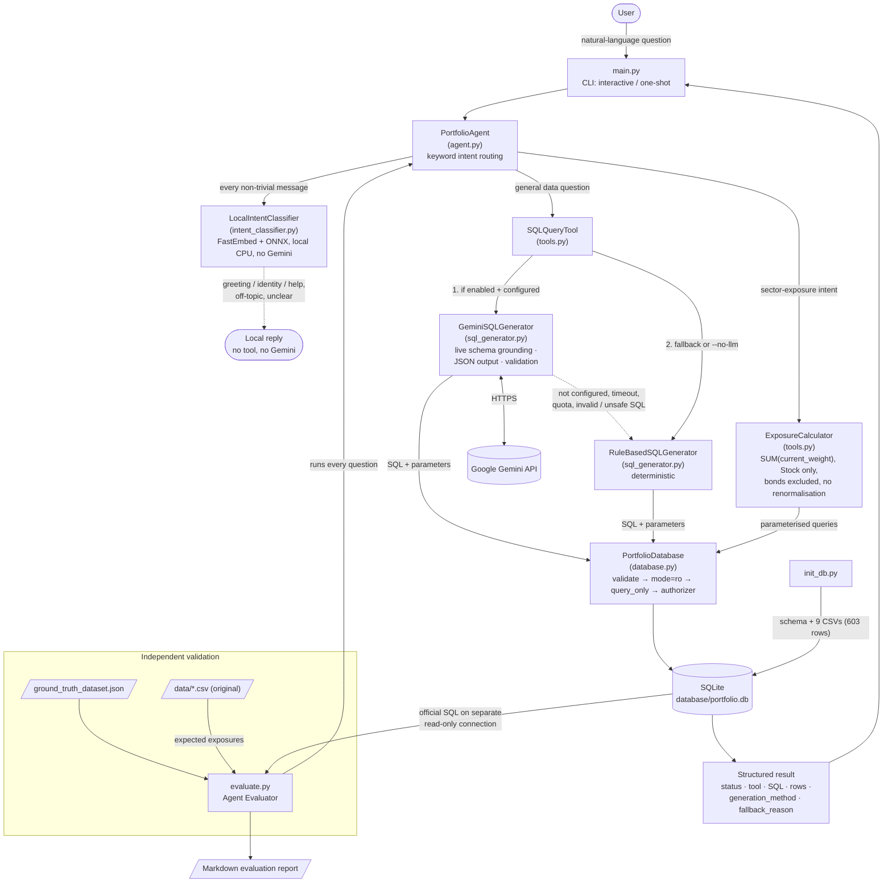
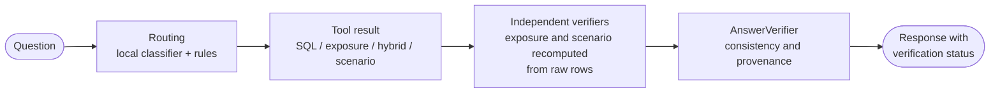

# PL Capital — AI Portfolio Analytics Agent

An AI agent that answers natural-language questions about investment-portfolio data, from the command line
and through a local web interface. Each question is routed to the right tool: a **SQL Query Tool**
(natural language → read-only SQL, generated by Google Gemini with a deterministic fallback), a deterministic
**Exposure Calculator**, a **hybrid** analysis that combines both, or a **scenario / stress-testing** tool.
Every financial figure is checked by an independent verifier before it is shown, and an **Agent Evaluator**
scores the agent against the supplied ground truth.

Built for the PL Capital (Prabhudas Lilladher Group) AI/ML Intern Round 2 technical assessment.
The original assessment brief is preserved unchanged in
[docs/ORIGINAL_ASSESSMENT_README.md](docs/ORIGINAL_ASSESSMENT_README.md).

**Live demo:** [https://pl-capital-portfolio-analytics.vercel.app/](https://pl-capital-portfolio-analytics.vercel.app/) — the application is deployed on Vercel with reviewer access-code authentication and live Gemini integration (`gemini-3.5-flash-lite`). It runs on the supplied sample dataset and supports natural-language portfolio questions, validated read-only SQL, deterministic calculations, exposure analysis, and scenario analysis. Access requires a reviewer access code. See [Deploying on Vercel](https://github.com/THRILL3R/pl-capital-ai-portfolio-analytics-agent#deploying-on-vercel-reviewer-demo) for deployment and access configuration.

> **Results at a glance (verified locally, 2026-11-09)**
>
> | Area | Result |
> |---|---|
> | **Deterministic evaluation** (rule-based SQL, no API key) | **10 / 10** — [report](docs/EVALUATION_DETERMINISTIC.md) |
> | **Final live Gemini evaluation** (`gemini-3.5-flash-lite`, `evaluate.py --use-llm`) | **10 / 10** — [report](docs/EVALUATION_FINAL_LIVE_20261109.md) |
> | Q1–Q8 (SQL questions) | **Gemini-generated SQL: 8 / 8 passed, zero rule-based fallbacks** |
> | Q9–Q10 (sector exposure) | Deterministic `ExposureCalculator`: both passed |
> | Python tests (`unittest`) | **596 passed, 0 failed, 0 skipped** |
> | Frontend tests (Vitest) | **114 passed** |
> | SQL safety | Lexical checks → **SQLGlot AST validation** → read-only SQLite (`mode=ro`, `query_only`, authorizer) |
> | Financial verification | Exposure and scenario figures **recomputed independently** from raw rows before display |
> | Hybrid analysis | One answer combining database rows with verified sector exposure |
> | Scenario and stress testing | Deterministic hypothetical shocks, independently verified |
> | Final-answer verification | Every analytical response checked for consistency with its tool results |
> | Web interface | Responsive React + TypeScript app: Ask, Portfolios, Exposure, Evaluation, About |
>
> **Operating scope:** an assessment prototype over a supplied sample dataset. Run locally, its web API is unauthenticated
> and loopback-only; the hosted demo on Vercel sits behind a shared reviewer access code. See [Operating Scope](#operating-scope).

---

## Contents

1. [Assessment objective](#assessment-objective)
2. [Technical scope](#technical-scope)
3. [Architecture and Security](#architecture-and-security)
4. [Technology stack](#technology-stack)
5. [Project structure](#project-structure)
6. [Installation (Windows)](#installation-windows)
7. [Running the CLI](#running-the-cli)
8. [Running the evaluator](#running-the-evaluator)
9. [Gemini configuration](#gemini-configuration)
10. [Local intent classification (no Gemini)](#local-intent-classification-no-gemini)
11. [Financial calculation conventions](#financial-calculation-conventions)
12. [Verification approach](#verification-approach)
13. [Hybrid analysis (SQL + exposure)](#hybrid-analysis-sql--exposure)
14. [Scenario analysis and stress testing](#scenario-analysis-and-stress-testing)
15. [SQL generation: Gemini with deterministic fallback](#sql-generation-gemini-with-deterministic-fallback)
16. [Web interface](#web-interface)
17. [Deploying on Vercel (reviewer demo)](#deploying-on-vercel-reviewer-demo)
18. [Running the tests](#running-the-tests)
19. [Evaluation methodology and results](#evaluation-methodology-and-results)
20. [Operating Scope](#operating-scope)
21. [Further documentation](#further-documentation)

---

## Assessment objective

The assessment requires four components (see the [original brief](docs/ORIGINAL_ASSESSMENT_README.md)):

| # | Required component | Implementation |
|---|---|---|
| A | **SQL Query Tool** — natural-language question → SQL → portfolio data | `SQLQueryTool` + `GeminiSQLGenerator` / `RuleBasedSQLGenerator` |
| B | **Exposure Calculator** — sector exposure per portfolio, **equities only, bonds excluded** | `ExposureCalculator` |
| C | **Portfolio Agent** — command-line agent that picks the right tool | `PortfolioAgent` + `main.py` |
| D | **Agent Evaluator** — runs the ground-truth questions and checks the answers | `evaluate.py` → Markdown report |

On top of the required components the project adds hybrid analysis, scenario testing, independent
verification layers, a local intent classifier and a web interface, all described below.

## Technical scope

- **Command-line agent** with interactive and one-shot modes, JSON or human-readable output.
- **Intelligent routing** between the SQL Query Tool, the Exposure Calculator, the hybrid tool and the scenario
  tool. Greetings, capability questions, off-topic and unclear messages are handled locally by a semantic
  intent classifier, with no tool and no Gemini call.
- **Gemini SQL generation** with the official `google-genai` SDK: live-schema grounding, structured JSON output
  (`sql`, `parameters`, `description`), parameterised `?` placeholders, timeout and retry limits, and categorised
  errors (quota, timeout, network, auth, malformed output, unsafe SQL).
- **Deterministic fallback**: a rule-based generator answers all eight ground-truth SQL questions with no API
  key, and Gemini failures fall back automatically with the reason reported in the response.
- **SQL safety in depth**: lexical validation (single `SELECT`/`WITH`, no comments, no write/admin keywords) →
  **SQLGlot AST validation** (SQLite dialect: one SELECT or set operation, no DML/DDL/`PRAGMA` anywhere in the
  tree, only the schema's tables or the statement's own CTEs, no table-valued or file/extension functions) →
  read-only SQLite URI (`mode=ro`) → `PRAGMA query_only` → SQLite authorizer denying writes, DDL, `ATTACH`
  and `PRAGMA`. Gemini never executes SQL itself.
- **Deterministic financial calculations**: exposure = `SUM(current_weight)` of Stock holdings per sector,
  ×100, bonds excluded, no renormalisation. Gemini is never used for arithmetic.
- **Independent financial verification**: exposure and scenario results are recomputed by separate components
  from raw rows before display; figures that cannot be verified are withheld.
- **Hybrid SQL + exposure analysis**: one question can return database rows and a verified sector exposure
  together.
- **Scenario and stress testing**: predefined and custom hypothetical sector shocks, calculated with
  `decimal.Decimal` and independently re-verified.
- **Final-answer verification**: every analytical response is checked for consistency with its structured tool
  results.
- **Reproducible database build** from the original CSVs: atomic rebuild, foreign keys enforced, 603 records
  verified, integrity checks.
- **Independent evaluator**: expected answers come from the official SQL (run on a separate read-only
  connection) and from the original CSV files, never from the agent.
- **Responsive React web interface** with an optional local FastAPI adapter.

## Architecture and Security

### Data flow



### Verification layers



### Module responsibilities

| Module | Role |
|---|---|
| `main.py` | CLI entry point: argument parsing, `.env` loading, interactive loop, JSON / `--pretty` output, exit codes. |
| `init_db.py` | Builds `database/portfolio.db` from `database_schema.sql` and the nine CSVs; prints counts and integrity results. |
| `evaluate.py` | Agent Evaluator: independent expected answers, PASS/FAIL comparison, Markdown report. |
| `portfolio_agent/agent.py` | `PortfolioAgent`: input validation, routing, portfolio-name extraction, tool dispatch, uniform response. |
| `portfolio_agent/tools.py` | `SQLQueryTool` (Gemini-first with deterministic fallback) and `ExposureCalculator` (portfolio resolution + equity exposure). |
| `portfolio_agent/sql_generator.py` | `GeminiSQLGenerator` (google-genai, schema-grounded, validated JSON output) and `RuleBasedSQLGenerator` (deterministic patterns for the supplied questions). |
| `portfolio_agent/database.py` | `PortfolioDatabase`: CSV ingestion, schema introspection, integrity checks, SQL validation and guarded read-only execution. |
| `portfolio_agent/sql_ast.py` | SQLGlot AST validation: an independent syntax-tree safety layer for every statement (mandatory; fails closed). |
| `portfolio_agent/financial_verifier.py` | `FinancialVerifier`: independent recomputation and comparison of exposure results (no shared code or SQL aggregation with `ExposureCalculator`); response policy for failed or unverified results. |
| `portfolio_agent/hybrid_tool.py` | `HybridAnalysisTool`: answers questions that need both database data and sector exposure by coordinating `SQLQueryTool`, `ExposureCalculator` and `FinancialVerifier`. |
| `portfolio_agent/scenario_tool.py` | `ScenarioTool`: deterministic hypothetical scenario / stress test (weight × shock, Decimal arithmetic, never renormalised). |
| `portfolio_agent/scenario_verifier.py` | `ScenarioVerifier`: independent recomputation of every scenario result (exact fractions from raw rows, no shared code). |
| `portfolio_agent/answer_verifier.py` | `AnswerVerifier`: checks that the final response is consistent with its structured tool results. No calculation, database or model access. |
| `portfolio_agent/intent_classifier.py` | `LocalIntentClassifier`: local semantic intent detection (FastEmbed + ONNX, cached prototype embeddings, per-intent thresholds, margin and mixed-message guard). Prototypes in `intent_examples.py`. |
| `portfolio_api/` | FastAPI adapter that wraps the agent for the web interface and returns the agent's own responses; optional reviewer access control (`auth.py`) and request limits (`limits.py`). |
| `scripts/gemini_smoke_test.py` | Manual **live** Gemini check (makes real API calls; not part of the test suite). |

### Security controls and API-key handling

- **Read-only data access.** Every statement passes lexical validation and SQLGlot AST validation, then runs on a
  read-only SQLite connection with `query_only` and an authorizer. Literal values are bound as parameters.
- **Gemini is a generator, not an executor.** Its output is validated before execution and is never executed by
  the generator itself. The user question is treated as data in the prompt (prompt-injection guard), and any SQL
  it produces must still pass every read-only control.
- **Secrets stay server-side.** Keys, the access code and the session secret live only in `.env` (git-ignored) or in the
  hosting environment's variables; `.env.example` holds placeholders only. The API key is never printed or logged: error messages are redacted, the generator's `repr`
  hides it, the smoke test reports only `present` / `MISSING`, and the web layer never sends keys to the browser.
- **Generated artefacts** (`database/*.db`, virtual environments, caches, logs) are git-ignored.
- **Local by default; a shared reviewer access code when hosted.** Run locally, the adapter binds to `127.0.0.1`; in every
  mode it validates the `Host` header and enables no CORS. When `REVIEWER_ACCESS_CODE` and `SESSION_SECRET` are set (mandatory
  on Vercel) every data endpoint requires a signed `HttpOnly` session cookie, login attempts and requests are limited, and the
  hosted entry point fails closed without that configuration and never enables Gemini behind an open API (see
  [Deploying on Vercel](#deploying-on-vercel-reviewer-demo) and [Operating Scope](#operating-scope)).

See [docs/GITHUB_READINESS.md](docs/GITHUB_READINESS.md) for the full security review and the pre-publication
checklist.

## Technology stack

| Area | Choice |
|---|---|
| Language | Python 3.13 (developed and tested on 3.13.16) |
| Database | SQLite (standard-library `sqlite3`) |
| SQL validation | SQLGlot 30.30.0 (SQLite dialect AST) |
| LLM | Google Gemini via the official `google-genai` SDK (tested with 3.0.0); model used for the final evaluation: `gemini-3.5-flash-lite` |
| Local intent model | FastEmbed 0.9.1 + ONNX Runtime (`sentence-transformers/all-MiniLM-L6-v2`, CPU, no PyTorch) |
| Configuration | `python-dotenv` (`.env` file) |
| Web API | FastAPI + Uvicorn + Pydantic (loopback only locally; Vercel for the public demo) |
| Frontend | React 19, Vite, TypeScript, Tailwind CSS, Vitest |
| Testing | `unittest` (Python), Vitest (frontend) |
| Interface | Command line (`argparse`) and web |

## Project structure

```
Exercise_PL_AI_Engineer/
├── main.py                       # CLI agent (mandatory interface)
├── evaluate.py                   # Agent Evaluator
├── init_db.py                    # Database builder
├── vercel.json                   # Vercel services: frontend + FastAPI adapter
├── vercel_app.py                 # Vercel entry point for the FastAPI adapter
├── pyproject.toml                # runtime-only dependencies for the Vercel deployment
├── .vercelignore                 # files the Vercel CLI must never upload (.env, caches, database)
├── evaluation_report.md          # Default output path of evaluate.py (see docs/ for the committed evaluation reports)
├── portfolio_agent/
│   ├── agent.py                  # PortfolioAgent (routing)
│   ├── tools.py                  # SQLQueryTool, ExposureCalculator
│   ├── sql_generator.py          # GeminiSQLGenerator, RuleBasedSQLGenerator
│   ├── database.py               # PortfolioDatabase (ingestion, safety, execution)
│   ├── sql_ast.py                # SQLGlot AST validation
│   ├── financial_verifier.py     # independent exposure verification
│   ├── hybrid_tool.py            # SQL + exposure analysis
│   ├── scenario_tool.py          # scenario / stress testing
│   ├── scenario_verifier.py      # independent scenario verification
│   ├── answer_verifier.py        # final-answer consistency checks
│   ├── intent_classifier.py      # local semantic intent classifier
│   └── intent_examples.py        # classifier prototypes
├── portfolio_api/                # HTTP adapter for the web UI (FastAPI; wraps the agent unchanged) + access control and limits
├── frontend/                     # React + Vite + TypeScript web interface (see frontend/README.md)
├── scripts/
│   ├── gemini_smoke_test.py      # Manual live Gemini check
│   ├── download_intent_model.py  # One-off local model download
│   ├── calibrate_intents.py      # Intent-classifier calibration
│   └── test_*.py                 # Optional live model benchmarks (make real API calls)
├── tests/                        # 596 unit tests (no live API calls); tests/__init__.py makes the suite hermetic
├── docs/
│   ├── ORIGINAL_ASSESSMENT_README.md     # original brief, byte-identical
│   ├── PROJECT_OVERVIEW.md               # technical overview
│   ├── GITHUB_READINESS.md               # publication + security checklist
│   ├── EVALUATION_FINAL_LIVE_20261109.md # final live Gemini evaluation (10/10)
│   ├── EVALUATION_DETERMINISTIC.md       # deterministic evaluation (10/10)
│   ├── INTENT_CLASSIFIER_CALIBRATION.md  # classifier method and results
│   ├── PROMPT_IMPROVEMENT_REPORT.md      # Gemini prompt design and impact
│   └── EVALUATION_*.md, GEMINI_MODEL_BENCHMARK.md, ARGON_*.md, *.csv   # additional run and benchmark records
├── data/                         # 9 original CSV datasets (unchanged)
├── database/                     # generated portfolio.db (git-ignored)
├── database_schema.sql           # official schema (unchanged)
├── ground_truth_dataset.json     # official ground truth (unchanged)
├── requirements.txt              # pinned dependencies
├── .env.example                  # configuration template (placeholders only)
└── .gitignore
```

## Installation (Windows)

Prerequisites: Python 3.11–3.13 (3.13 recommended) and PowerShell. All commands are run from the
project root.

```powershell
# 1. Create and activate a virtual environment
py -3.13 -m venv .venv
.\.venv\Scripts\Activate.ps1
#    (If script execution is blocked: Set-ExecutionPolicy -Scope CurrentUser RemoteSigned)
#    You can also skip activation and call .\.venv\Scripts\python.exe directly, as below.

# 2. Install the dependencies (RECOMMENDED: the full pinned list; this is the supported full installation)
.\.venv\Scripts\python.exe -m pip install -r requirements.txt
#    - sqlglot (pinned) is MANDATORY: without it every SQL query is rejected before execution (fail closed).
#    - fastapi, uvicorn, pydantic and httpx are REQUIRED to run the web API / frontend and their tests.
#    - google-genai and python-dotenv are needed for the optional Gemini integration.
#    - fastembed (pinned, no PyTorch) powers the local intent classifier (step 3).

# 3. Optional but recommended: download the local intent-classifier model once (~90 MB)
.\.venv\Scripts\python.exe scripts\download_intent_model.py
#    Without it the agent still works (see "Local intent classification" below).

# 4. Build the SQLite database from the original CSVs (603 records)
.\.venv\Scripts\python.exe init_db.py
#    Rebuild from scratch at any time:
.\.venv\Scripts\python.exe init_db.py --reset
```

> **Windows long-path note.** The full `requirements.txt` install includes Streamlit, whose package contains very
> deeply nested files. If the project lives in a long directory path, `pip` can fail with
> `OSError: [WinError 206] The filename or extension is too long`. Move the project to a shorter path or enable
> Windows long-path support (preferred). As a last resort you can install only what the CLI and tests need,
> **keeping SQLGlot**: `pip install google-genai python-dotenv sqlglot==30.30.0 numpy` (add
> `fastapi uvicorn pydantic httpx` for the API). That is a reduced setup, not the full application.

Gemini is optional: without an API key the agent and evaluator run fully in deterministic mode.

## Running the CLI

```powershell
# Interactive mode (type 'exit', 'quit' or 'q' to leave)
.\.venv\Scripts\python.exe main.py --pretty

# One-shot question, JSON output
.\.venv\Scripts\python.exe main.py -q "How many portfolios do we have in total?"

# One-shot, human-readable output, Gemini disabled
.\.venv\Scripts\python.exe main.py --no-llm --pretty -q "Calculate the sector exposure breakdown for international equity"
```

| Option | Meaning |
|---|---|
| `-q`, `--question` | Answer one question and exit (otherwise interactive mode). |
| `-p`, `--pretty` | Human-readable tables instead of JSON. |
| `--no-llm` | Disable Gemini; use the deterministic rule-based SQL generator only. |
| `--db PATH` | Use a different SQLite database file. |

Exit code is `0` for `success`, `unsupported`, `no_equity_holdings` and `conversation` responses, `1` for errors.

A message that is *entirely* a greeting, thanks or goodbye (for example `hi`, `good morning`, `thanks`) is answered
by the agent itself with status `conversation` and four example questions. No tool and no Gemini call is involved,
with or without `--no-llm`. A greeting combined with a real question (`hi, show me the top holdings`) is passed to
the analytical pipeline unchanged.

### Example questions

| Question | Tool |
|---|---|
| How many portfolios do we have in total? | SQL Query Tool |
| What are the names of all active portfolios? | SQL Query Tool |
| Which securities are in the Technology sector? | SQL Query Tool |
| What is the total Assets Under Management (AUM) for portfolios with high target risk level? | SQL Query Tool |
| Show me the top 5 holdings by cost basis in the Growth Equity Fund | SQL Query Tool |
| What is the average current price of securities in each sector? | SQL Query Tool |
| What is the Technology market value for each portfolio? | SQL Query Tool |
| Find portfolios that have holdings in more than 5 different sectors and show their diversification metrics | SQL Query Tool |
| What are the sector exposures for the Tech Innovation Fund? | Exposure Calculator |
| Show sector allocation for International Equity | Exposure Calculator |
| Show the holdings and sector exposure breakdown for the International Equity Fund | Hybrid analysis |
| Stress test the International Equity Fund under a 20% market decline | Scenario analysis |

Example output (deterministic mode):

```
> python main.py --no-llm --pretty -q "Calculate the sector exposure breakdown for international equity"
  Status : success
  Tool   : exposure_calculator
  Reason : Question matched sector-exposure intent for portfolio 'international equity'.

  Portfolio: International Equity Fund
  Basis   : SUM(holdings.current_weight) grouped by security sector
  Filter  : Equities only (asset_type='Stock'); bond holdings excluded

  | Sector           | Exposure % | Holdings |
  |------------------|------------|----------|
  | Energy           | 38.00%     | 2        |
  | Technology       | 36.00%     | 4        |
  | Automotive       | 15.00%     | 1        |
  | Consumer Staples | 11.00%     | 1        |
  Total equity weight: 100.00%
  ...

> python main.py --no-llm --pretty -q "What is the total Assets Under Management (AUM) for portfolios with high target risk level?"
  Status : success
  Tool   : sql_query
  Method : rule_based

  SQL:
    SELECT SUM(total_aum) FROM portfolios WHERE target_risk_level = ?
  Parameters: ['High']
  Rows returned: 1

  | SUM(total_aum) |
  |----------------|
  | 85000000.0     |
```

## Running the evaluator

```powershell
# Deterministic evaluation (default): rule-based SQL, no API key, no network calls
.\.venv\Scripts\python.exe evaluate.py

# Gemini-enabled evaluation (makes live API calls; 8 requests for Q1-Q8)
.\.venv\Scripts\python.exe evaluate.py --use-llm

# Evaluate selected questions only (e.g. Q5 and Q7)
.\.venv\Scripts\python.exe evaluate.py --use-llm --questions 5,7
```

| Option | Meaning |
|---|---|
| `--use-llm` | Generate SQL with Gemini (falls back per question on failure; fallbacks are reported). |
| `--questions IDS` | Evaluate only these ground-truth IDs (e.g. `7` or `5,7`). The report is labelled as a **subset run**, and by default goes to `evaluation_report_subset.md` so it never overwrites the full report. |
| `--report PATH` | Markdown report path (default `evaluation_report.md`). `--no-report` skips it. |
| `--db`, `--data-dir`, `--ground-truth` | Override input locations. |

The evaluator prints a PASS/FAIL table, writes the report and exits `0` only if every evaluated
question passes. How expected answers are computed:

- **Q1–Q8 (text2sql)** — the official `sql_query` from `ground_truth_dataset.json` is executed
  unchanged on a separate read-only `sqlite3` connection. The agent must return the same number of
  rows and matching values (tolerance abs 1e-6 / rel 1e-9); row order must match where the official
  query uses `ORDER BY`. Column aliases may differ.
- **Q9–Q10 (exposure)** — recomputed from the original CSV files: `SUM(current_weight) × 100` per
  sector for `asset_type = 'Stock'`, bonds excluded, no renormalisation. The agent must resolve the
  same portfolio and return exactly these sectors and percentages.
- Every question must also be routed to the tool its ground-truth `type` specifies.

The report labels which Gemini client was used (`none`, `live`, `mock`, `unconfigured`), so a
mocked or unconfigured run can never be presented as live evidence.

## Gemini configuration

Gemini is optional. To enable it:

1. Create an API key in [Google AI Studio](https://aistudio.google.com/).
2. Copy the template and edit the copy (never put a real key in `.env.example`):
   ```powershell
   Copy-Item .env.example .env
   notepad .env
   ```
3. Settings read from `.env` or the environment:

   | Variable | Default | Purpose |
   |---|---|---|
   | `GEMINI_API_KEY` | — | Required for Gemini; if absent the agent runs deterministically. |
   | `GEMINI_MODEL` | `gemini-3.8-flash` | Model identifier (single default in `sql_generator.py`). The final live evaluation used `gemini-3.5-flash-lite`; set `GEMINI_MODEL=gemini-3.5-flash-lite` in `.env` to reproduce it. |
   | `GEMINI_TIMEOUT_SECONDS` | `30` | Per-request timeout (sent to the API as the server deadline). |
   | `GEMINI_MAX_ATTEMPTS` | `2` | Attempts including the first (`1` = no retries). |

4. Run the live smoke test (makes a few small, real API calls; never prints the key):
   ```powershell
   .\.venv\Scripts\python.exe scripts\gemini_smoke_test.py
   ```
   Exit code `0` = all checks passed, `1` = a check failed, `2` = not configured.

**Live validation.** The final full live evaluation (2026-11-09) used `gemini-3.5-flash-lite` and scored
**10/10**: Q1–Q8 were answered with Gemini-generated SQL (8/8 passed, zero rule-based fallbacks) and Q9–Q10 by the
deterministic `ExposureCalculator`. See the [report](docs/EVALUATION_FINAL_LIVE_20261109.md). Prompt design and its
measured impact are described in [docs/PROMPT_IMPROVEMENT_REPORT.md](docs/PROMPT_IMPROVEMENT_REPORT.md), and model
selection results in [docs/GEMINI_MODEL_BENCHMARK.md](docs/GEMINI_MODEL_BENCHMARK.md).

## Local intent classification (no Gemini)

Before any analytical tool runs, a small **local** classifier decides what kind of message the user sent.
It is separate from, and never calls, Gemini.

```text
message ──► exact greeting / thanks / goodbye rules (instant)
        └─► LocalIntentClassifier  (FastEmbed + ONNX Runtime, sentence-transformers/all-MiniLM-L6-v2, CPU)
               embed the message  →  cosine similarity with cached example embeddings per intent
               per-intent minimum score  +  required margin over the runner-up  +  mixed-message guard
                 │
                 ├─ conversational (greeting, thanks, goodbye, identity, capabilities) → local reply
                 ├─ portfolio analytics → original question, unchanged → SQL path (Gemini-first + fallback)
                 ├─ sector exposure     → ExposureCalculator (deterministic; Gemini never involved)
                 ├─ unrelated / out of scope → friendly local "unsupported" reply
                 └─ uncertain → local clarification request with example questions
```

**Which questions use Gemini?**

| Message category | Handled by | Gemini called? |
|---|---|---|
| Greeting, thanks, goodbye, "who are you?", "what can you do?" | Local replies | No |
| Off-topic questions (weather, sports, general knowledge, advice, data changes) | Local reply | No |
| Vague or ambiguous messages | Local clarification with examples | No |
| Sector exposure | `ExposureCalculator` | No, never |
| Portfolio / holdings / securities questions | `SQLQueryTool` | Only if Gemini is enabled and configured; otherwise the rule-based generator |

A greeting *combined* with a real question ("Hi, how many portfolios do we have?") is not intercepted: the whole
original message reaches the analytical pipeline. If the classifier cannot tell, it asks for clarification rather
than dropping part of the question.

**Historical and risk questions.** A question about a portfolio's *stored* history or risk data (maximum drawdown,
returns, performance, volatility, Sharpe / Sortino, VaR / CVaR, tracking error, beta, NAV, "last year", "in 2023")
goes to the SQL tool even if the classifier leans towards sector exposure, "unsupported" or "unclear" (a portfolio
or fund must be mentioned, and conversational verdicts are left alone). Explicit exposure wording, hybrid and
scenario questions keep their routes. With Gemini enabled, the SQL tool answers these by generating a read-only
query over the stored records; the rule-based generator covers the supplied question patterns.

### One-off setup

```powershell
.\.venv\Scripts\python.exe -m pip install -r requirements.txt   # includes fastembed==0.9.1 (ONNX Runtime, no PyTorch)
.\.venv\Scripts\python.exe scripts\download_intent_model.py      # ~90 MB, needs internet once
```

After that the model loads from disk and **no network is used** for classification. The model is never
downloaded implicitly while serving a request. If it has not been downloaded, the CLI (interactive mode) and
`python -m portfolio_api` print the setup instructions at startup.

- **Cache location:** `<project>/.model_cache/fastembed` (git-ignored). Override with `PORTFOLIO_INTENT_CACHE_DIR`.
- **Speed:** the model and the example embeddings load once per process (about one second from the cache on
  the development machine) and each message then takes a few milliseconds on CPU.

### Configuration (environment variables)

| Variable | Default | Meaning |
|---|---|---|
| `PORTFOLIO_INTENT_CLASSIFIER` | `on` | `off` disables the classifier entirely (everything except exact greetings goes to the SQL tool). Also `--no-intent-classifier` on `main.py` and `python -m portfolio_api`. |
| `PORTFOLIO_INTENT_CACHE_DIR` | `.model_cache/fastembed` | Where the model is stored. |
| `PORTFOLIO_INTENT_MODEL` | `sentence-transformers/all-MiniLM-L6-v2` | Embedding model name. Changing it requires re-calibration. |
| `PORTFOLIO_INTENT_ALLOW_DOWNLOAD` | `0` | `1` lets the first use download a missing model. |
| `PORTFOLIO_INTENT_THRESHOLDS` | calibrated defaults | JSON override, e.g. `{"min_score": {"IDENTITY": 0.6}, "min_margin": 0.05, "mixed_floor": 0.5, "mixed_gap": 0.2}`. |

Thresholds are cosine similarities, **not probabilities**, and are never shown to users. Defaults are in
`portfolio_agent/intent_classifier.py`; the method and results are in
[docs/INTENT_CLASSIFIER_CALIBRATION.md](docs/INTENT_CLASSIFIER_CALIBRATION.md). To add new wording, add
examples to `portfolio_agent/intent_examples.py` (no code changes), then run
`python scripts/calibrate_intents.py`.

### Safe behaviour without the model

The classifier **fails safe**: Gemini is *not* used merely because classification was unavailable. Exact
greetings still work; exposure questions still use the calculator; database questions run through the
deterministic rule-based generator, and the response says so (`fallback_used: true` with the reason). Run the
setup commands above to enable semantic classification, or set `PORTFOLIO_INTENT_CLASSIFIER=off` to use plain
routing.

## Financial calculation conventions

All financial figures are deterministic. Gemini never performs arithmetic.

| Quantity | Definition |
|---|---|
| Sector exposure (Q9–Q10 and the Exposure Calculator) | `SUM(holdings.current_weight) × 100` per sector, **Stock holdings only**, bonds excluded, **no renormalisation** |
| Market value share (Q7) | `quantity × current_price` as a share of total portfolio value, bonds included (the official definition) |
| Diversification (Q8) | distinct Stock sectors ÷ all holdings (the supplied definition) |
| Scenario impact | `SUM(w × shock%)` over sectors; Decimal arithmetic; weights never renormalised |

The Q7 and Q8 definitions intentionally differ from the weight-based exposure used for Q9–Q10. Bond exclusion is
additionally exercised by synthetic-data unit tests, because the portfolios in Q9 and Q10 hold no bonds. Stored
performance and risk values are shown as recorded, with no units added.

## Verification approach

The agent verifies its results in layers: SQL is validated before execution, financial figures are recomputed by
independent components, and the final response is checked against its structured tool results.

### Independent financial verification

`ExposureCalculator` answers with one SQL aggregate. `FinancialVerifier` then recomputes the same figures by a
different route and compares them, so an error in the calculator's query, filter or arithmetic is caught
instead of being shown.

- **Independent path.** It never imports or calls the calculator. It reads raw rows with four plain
  single-table `SELECT`s (one portfolio's holdings, all securities, all sectors, the portfolio row) and does
  the joining (dictionary look-ups), the Stock-only filter and the summation (`math.fsum`) in Python. There is
  no JOIN, GROUP BY or SUM in its SQL. Tests enforce all of this and show that a calculator with a deliberately
  wrong SQL query is caught.
- **Same conventions, nothing redefined.** Stock holdings only, bonds excluded, exposure = sum of
  `current_weight` × 100, no renormalisation; unmapped stocks are counted but have no sector; a zero-weight
  stock keeps its sector at 0%.
- **Tolerance** is the evaluator's: 1e-4 percentage points per sector (the total allows that per sector,
  because the calculator rounds each sector first); weight fractions 1e-6.
- **What it checks:** portfolio identity, missing / unexpected / duplicate sectors, sector percentages,
  fractions and holding counts, totals (including a total that matches the displayed sectors), bond exclusion,
  renormalisation, and total / equity / bond / unmapped counts and status.
- **Fail-safe policy.** Figures that are not verified are never shown as a normal result.
  - `failed` (the recomputation disproves them): status becomes `error`, `exposures` and the total are
    cleared, and `error` says the result failed independent verification.
  - `unverified` (verification could not be completed, e.g. a database error): treated the same way, with the
    message "Independent verification could not be completed, so the exposure figures have been withheld."
  - `verification.status` keeps the two cases distinct, and the calculator's figures are kept only in
    `result.verification.rejected_result` for diagnosis.
  - `verified` results are unchanged plus `verification.status = "verified"`. Results that were already errors
    are left untouched.
  - With no verifier configured (`financial_verifier=None`) figures are withheld as `unverified`
    ("Independent financial verification is disabled or unavailable"), including in the hybrid tool.
- **Where you see it.** The web UI shows a badge — **Independently verified** (green), **Verification failed**
  (red) or **Could not be verified** (neutral) — on the Ask answer and the Exposure page. `--pretty` CLI output
  prints `Verification: VERIFIED | FAILED | UNVERIFIED`.
- **Where it runs:** the agent (`PortfolioAgent`, used by the CLI, evaluator and chat) and `POST /api/exposure`.
  Its queries use `execute_read_only`, so SQLGlot AST validation, the read-only connection, `query_only` and the
  authorizer all apply. Gemini is never involved.

### Final-answer verification

The application does not generate free-form analytical answers. Gemini only returns `{sql, parameters, description}`;
every analytical response is a direct tool result, deterministic text built from tool results, or Gemini's
one-sentence `description` of its own SQL. `AnswerVerifier` (`portfolio_agent/answer_verifier.py`) therefore checks
the *consistency and provenance* of the structured response. It adds no second Gemini call and does no financial
calculation, database access or arithmetic (tests enforce this).

Every analytical `result` carries an `answer_verification` block: `status` (`verified` | `failed` | `unverified` |
`not_applicable`), `checks_run`, `mismatch_count`, `mismatches`, `checks_skipped`, `unverified_claims`, a
deterministic `summary`, and the `method`.

| Response | Checked |
|---|---|
| SQL | status valid and equal to the response status; `row_count` equals the number of rows; rows match the declared columns; successful results include their SQL; failed results carry no rows; fallback metadata coherent |
| Exposure | a displayed result carries a `verified` financial verification with no mismatches **and a digest of the figures that were verified** (so any change before display is caught); identity, counts and status coherent; failed / unverified results show no figures |
| Scenario | the independent scenario verification is `verified` and its digest matches the figures about to be shown (so any change after verification is caught); identity, scenario type/id, shock assumptions within -100%..+100%, hypothetical / not-forecast flags and disclaimer, sector-impact structure, sign consistency, coverage metadata and the status; failed or unverified scenarios show no figures. The arithmetic is not repeated here: `ScenarioVerifier` already recomputed it |
| Hybrid | both components pass their own checks; same canonical portfolio in both; `component_status` matches the components; overall status, `complete` (true only when both succeed), `issues`, `error` and `summary` match what actually succeeded |

If a check fails, the affected data is withheld (rows or exposure figures cleared, status `error`, a clear message),
with counts and rejected values kept only inside `answer_verification.rejected_result`. A hybrid with one good
component stays `partial`, and a status is never made more successful than the evidence. If the verifier itself
cannot run, the data is withheld and the block says `unverified`.

**Scope.** Verification confirms that a response agrees with what its tools returned. Gemini's `query_description`
is listed under `unverified_claims`; the UI shows a deterministic headline from the tool result ("5 rows returned")
and the model's sentence below it, labelled *Model-generated description (not verified)*. The verifiers check the
agent's results against the database and against each other; they do not judge the sample data itself or whether
Gemini's SQL matches the user's intent.

## Hybrid analysis (SQL + exposure)

Some questions need both a database answer and a sector exposure, for example *"Show the holdings and sector
exposure breakdown for the International Equity Fund"*. These are routed to `HybridAnalysisTool`
(`selected_tool: "hybrid_analysis"`); every other question keeps its route.

| Question type | Example | Tool |
|---|---|---|
| SQL only | "Show the top five holdings by cost basis" | `SQLQueryTool` |
| Exposure only | "What are the sector exposures of the International Equity Fund?" | `ExposureCalculator` + `FinancialVerifier` |
| Both | "Show the holdings and sector exposure breakdown for the International Equity Fund" | hybrid |

- **Deterministic routing, no Gemini call.** A question is hybrid when it names exposure explicitly (exposure
  signal from the keyword rules or the local classifier, and the word "exposure" or "sector allocation/mix/..."
  in the text), also asks for portfolio data (holdings, positions, securities, cost basis, top N, ...) and joins
  them with "and", "plus", "along with" or a comma. None of the ten official questions is hybrid.
- **One portfolio for both parts.** The name is resolved once with the calculator's own resolver; if it is
  unknown or ambiguous, neither part runs.
- **Exposure:** computed by the deterministic calculator and independently verified under the same fail-safe
  policy. Gemini never sees it.
- **Data part:** the exposure wording is removed from the question and the canonical portfolio name inserted, then
  `SQLQueryTool` answers it exactly as for any SQL question (Gemini-first with the deterministic fallback; every
  statement passes lexical and SQLGlot AST validation on the read-only database). For a plain "holdings" request
  the rule-based generator has one narrow rule (holdings list of a named portfolio), checked after the official
  patterns so none of their behaviour changes.
- **Result contract.** `result` = `{tool, status, complete, portfolio, component_status, components: {sql,
  exposure}, issues, summary, error}`; `components.sql` is the SQL tool's normal result and
  `components.exposure` the verified exposure result.

| Outcome | Top-level status | `complete` |
|---|---|---|
| Both parts succeed | `success` | true |
| SQL fails, exposure verified | `partial` (exposure kept, SQL failure explained) | false |
| Exposure fails verification or is unverified; SQL succeeds | `partial` (exposure figures withheld, SQL kept) | false |
| Neither succeeds, or the portfolio cannot be resolved | `error` | false |

A partial result is always labelled as such: the UI shows a "Partial result" notice, the CLI prints "NOT a complete
result", and `main.py` exits non-zero. The web UI renders the SQL table and generated SQL, and the verified
exposure in its usual panels with the verification badge.

## Scenario analysis and stress testing

*"How could a hypothetical sector move affect this portfolio's recorded weights?"* Every result is a
**hypothetical illustration, not a forecast, not a prediction and not actual performance.**

**Formulas** (weights are recorded `holdings.current_weight` fractions of the portfolio; nothing is renormalised):

- sector contribution (percentage points of portfolio value) = `w × shock%`
- estimated portfolio impact = `SUM(w × shock%)` over sectors. Example: Technology 36% with a -25% shock = 0.36 × -25 = **-9.0 pp**
- estimated value impact = `total_aum × impact / 100`, shown only when the portfolio has a positive recorded AUM

**Rules.** Only Stock holdings mapped to a sector are shocked. Bonds are excluded (their weight is reported, not
modelled). Stock holdings with no sector are identified (count and weight) and contribute zero. Sectors without a
shock contribute exactly zero; shocks on sectors the portfolio does not hold are reported, not ignored. The result
states how much of the recorded weight is shocked, unchanged, unmapped, excluded as bonds, and unaccounted for.
Shocks must be finite numbers within -100% and +100%; NaN, infinity, text, booleans and unknown sectors are
rejected. Arithmetic uses `decimal.Decimal`.

**Scenarios.** Predefined (illustrative): *Broad Market Downturn* (all mapped sectors -10%), *Severe Market Stress*
(-20%), *Technology Sell-off* (Technology -25%), *Energy Shock* (Energy -20%). Or custom: a market-wide shock and/or
sector shocks (sector shocks override the market shock).

**Independent verification.** `ScenarioVerifier` recomputes every result from raw holdings, securities, sectors and
portfolio rows with exact fractions (the engine uses Decimal and the calculator's output), re-states the predefined
scenarios itself, and checks identity, shock definition, sectors, exposures, applied shocks, each contribution, the
total, coverage, bond and unmapped weights, the currency impact and the hypothetical flags (tolerance 1e-4 pp). A
scenario that fails or cannot be verified (or has no verifier) has its figures withheld (status `error`, figures
only in `verification.rejected_result`), exactly like exposure. Gemini is never involved.

**Use it.** Ask: *"Stress test the International Equity Fund under a 20% market decline"*, *"What happens to the
Tech Innovation Fund if Technology falls 25%?"* or *"Run a severe market stress scenario for the Growth Equity
Fund"* (routing is deterministic; historical or descriptive questions such as drawdown or performance never match).
API: `POST /api/scenario` `{portfolio_name, scenario_id | market_shock_pct and/or sector_shocks}` and
`GET /api/scenarios`. The Exposure page has a *Scenario analysis* section.

## SQL generation: Gemini with deterministic fallback

For every non-exposure question `SQLQueryTool` does the following:

1. **Gemini enabled and `GEMINI_API_KEY` set** → `GeminiSQLGenerator` receives the live database
   schema, categorical values (exact portfolio/sector names, statuses, risk levels) and domain rules,
   and must return JSON `{"sql", "parameters", "description"}`. The output is validated (JSON shape,
   parameter types, placeholder count, read-only safety) and then executed by the read-only database
   layer.
2. **Fallback to `RuleBasedSQLGenerator`** happens when Gemini is not configured, the API call fails
   (timeout, quota/rate limit, network, auth, unknown model), the output is empty/malformed/unsafe,
   or the database rejects the SQL (e.g. an unknown column).
3. A **valid Gemini query that returns zero rows is a success**, not a fallback, because an empty result can be
   the correct answer.
4. `--no-llm` (CLI) or `use_gemini=False` makes the rule-based generator the primary method.

Every SQL response includes `generation_method` (`gemini` / `rule_based`), `model_name`, `fallback_used` and
`fallback_reason`. The Exposure Calculator never uses Gemini.

The Gemini prompt contains general, schema-level conventions (projection, ordering, granularity, category-exposure
scope, the diversification definition). It contains no question IDs, official SQL or expected answers;
`tests/test_prompt_conventions.py` enforces this.

## Web interface

A responsive React + Vite + TypeScript interface (Ask, Portfolios, Exposure, Evaluation, About) sits on top of the
existing agent. It is additional: the CLI and evaluator work without it. The web layer is a thin local adapter
(`portfolio_api/`, using FastAPI and Uvicorn from `requirements.txt`) that returns the agent's own responses. It
binds to `127.0.0.1` when run locally and never sends API keys to the browser. A hosted reviewer demo behind an access code is
described in [Deploying on Vercel](#deploying-on-vercel-reviewer-demo) (see also [Operating Scope](#operating-scope)). Full details: [frontend/README.md](frontend/README.md).

- **Ask:** a conversational interface with generated-SQL display, result tables, verification badges and
  hybrid and scenario answers.
- **Portfolios and Exposure:** portfolio views, sector-exposure charts and tables, and a scenario workbench.
- **Evaluation:** score tiles for the final live Gemini and deterministic evaluations, and a per-question matrix.
- **About:** a short description of the system.
- **Access screen (hosted demo):** a reviewer access-code screen and a Sign out button appear only when the server
  requires a code; a plain local run is unchanged.

```powershell
# one-time
cd frontend; npm install; npm run build; cd ..
# run (serves the built UI and the API on http://127.0.0.1:8000)
.\.venv\Scripts\python.exe -m portfolio_api            # add --no-llm for the rule-based generator only
```

## Deploying on Vercel (reviewer demo)

The repository includes a Vercel configuration ([vercel.json](vercel.json)) that deploys the React frontend and the
FastAPI adapter as one project with two services. A deployment runs at <https://pl-capital-portfolio-analytics.vercel.app>.
The page is reachable by URL, but the application and all of its data sit behind a **reviewer access code**.

| Service | Root | Serves |
|---|---|---|
| `frontend` | `frontend/` | The React app (Vite build) for every path except `/api/*`. Unknown paths fall back to `index.html`, so direct links such as `/evaluation` and `/portfolios` work. |
| `app` | repository root | The FastAPI adapter (entry point `vercel_app:app`) for `/api/*`. |

No service calls another (the browser calls `/api/*` directly), so no service bindings are used.

### Reviewer access

- **Access screen.** A reviewer opens the URL, enters the shared access code supplied with the submission, and the server
  starts a signed session. The code is checked on the server in constant time against `REVIEWER_ACCESS_CODE`. It is never
  stored in the browser (nothing in `localStorage` or `sessionStorage`), never part of the JavaScript bundle and never
  returned by any endpoint.
- **Session.** An HMAC-signed token in a `pl_session` cookie: `HttpOnly`, `SameSite=Strict`, `Secure` on HTTPS, `Path=/`,
  2-hour lifetime by default. It is signed with `SESSION_SECRET`, a separate secret that is never the access code or the
  Gemini key. Rotating the access code or the secret ends every existing session.
- **The API itself is protected, not just the page.** `/api/ask`, `/api/exposure`, `/api/scenario`, `/api/scenarios`,
  `/api/portfolios`, `/api/portfolios/{id}` and `/api/evaluation` answer `401` without a valid session, including to
  direct requests. Only `/api/auth/login`, `/api/auth/logout`, `/api/auth/session` and a minimal `/api/health`
  (`{"status": "ok"}` until signed in) are public. State-changing requests that a browser marks as cross-site are refused.
- **Sign out** clears the cookie and records the session as revoked.
- **Fails closed.** If `REVIEWER_ACCESS_CODE` or `SESSION_SECRET` is missing, too short (code at least 12 characters, secret
  at least 32), identical to each other or reused as the Gemini key, the hosted API refuses every data request with `503`,
  and Gemini stays off even if it is switched on.

### Environment variables

Names only: values are set in the Vercel project (use the dashboard and mark them Sensitive) and never in the repository.

| Variable | Needed | Purpose |
|---|---|---|
| `REVIEWER_ACCESS_CODE` | yes | The shared code reviewers type (at least 12 characters; random is best). |
| `SESSION_SECRET` | yes | Signing secret for session cookies (at least 32 random characters; used for nothing else). |
| `GEMINI_API_KEY` | for Gemini | Read only by the backend; never `VITE_`-prefixed, never logged and never returned. |
| `PORTFOLIO_USE_LLM` | for Gemini | `1` enables Gemini. Ignored unless access control is active. |
| `GEMINI_MODEL` | optional | Model name; the final evaluation used `gemini-3.5-flash-lite` (the code default is `gemini-3.8-flash`). |
| `PORTFOLIO_SESSION_TTL_SECONDS` | optional | Session lifetime, 300 to 86400 (default 7200). |
| `PORTFOLIO_LOGIN_MAX_ATTEMPTS`, `PORTFOLIO_LOGIN_GLOBAL_MAX_ATTEMPTS`, `PORTFOLIO_LOGIN_WINDOW_SECONDS` | optional | Login throttling (defaults: 5 per client and 60 in total per 600 s). |
| `PORTFOLIO_ASK_PER_MINUTE`, `PORTFOLIO_API_PER_MINUTE`, `PORTFOLIO_ASK_PER_DAY` | optional | Per-session request limits (defaults: 15 and 120 per minute; the daily cap is off). |
| `PORTFOLIO_ALLOWED_HOSTS`, `PORTFOLIO_DB_PATH` | optional | Custom domains (comma-separated) and the database location. |
| `UPSTASH_REDIS_REST_URL`, `UPSTASH_REDIS_REST_TOKEN` | optional | A shared store for limits and sign-out (see below). |

To make a random value without typing or printing it, run this in PowerShell and paste from the clipboard into the Vercel
dashboard: `$b = New-Object byte[] 32; [Security.Cryptography.RandomNumberGenerator]::Create().GetBytes($b); Set-Clipboard (($b | ForEach-Object { $_.ToString('x2') }) -join '')`.

### What the limits do and do not guarantee

Vercel runs several short-lived instances, so a counter held in memory is **per instance**: it slows guessing and bursts, but
it is not a deployment-wide guarantee. A shared limit and a sign-out that holds on every instance need a shared store. The
code supports an Upstash Redis database through its REST API and uses it only when both `UPSTASH_REDIS_REST_*` variables are
set (it is a separate account and service that this project does not require, and nothing here enables it). If the store is
unreachable, requests fall back to the per-instance counters and a warning is logged. The strength of the access code is the
main defence against guessing, and every attempt, failed or not, is also bounded by Vercel's own platform limits.

### How the hosted demo differs from a local run

- **Gemini.** With `PORTFOLIO_USE_LLM=1` and `GEMINI_API_KEY` set, free-form SQL questions are generated by Gemini on the
  server. Its output goes through the same lexical, SQLGlot AST and read-only controls as locally; unsafe or invalid SQL is
  rejected, and if Gemini fails, times out or is rejected, the deterministic generator answers and the response says which
  method produced it. Without the key (or without access control) the deterministic generator answers everything.
- **No local intent model.** The ~90 MB classifier model is not deployed, so routing uses the deterministic keyword rules.
- **Database.** SQLite is built from the bundled CSV files and schema in the instance's temporary directory on a cold
  start and queried through the same read-only controls as a local run. Nothing is persisted between instances and no
  user data is stored.
- **Evaluation page.** It reads the final live and deterministic report files that ship with the deployment.

### Deploy it yourself

```powershell
npm install --global vercel                       # or run it with npx
vercel login
vercel project create <project-name>
# In the Vercel dashboard (Project > Settings > Environment Variables) add, for Production:
#   REVIEWER_ACCESS_CODE, SESSION_SECRET, GEMINI_API_KEY (mark all three Sensitive), PORTFOLIO_USE_LLM=1, GEMINI_MODEL
vercel deploy --dry --project <project-name>      # review the file list first (see the note on .vercelignore)
vercel deploy --prod --project <project-name>
```

- **`.vercelignore` is required.** The Vercel CLI does not read `.gitignore` when it deploys a local folder; without
  `.vercelignore` it would upload `.env`, `.model_cache/`, `database/portfolio.db`, `frontend/dist` and `submission/`.
- **Dependencies.** The hosted API installs the runtime-only list in [pyproject.toml](pyproject.toml), not
  `requirements.txt`; the Python version is pinned in `.python-version`.
- **Redeploying.** Environment variable changes apply only to new deployments. `vercel git connect` redeploys on every push.

### Limitations of the hosted demo

- **One shared code.** It controls who can use the demo; it does not identify individuals, and anyone who has the code has
  full access. Rotate it (change the variable and redeploy) to cut off everyone.
- **Stateless sessions.** A copied session cookie stays valid until it expires unless the shared store is configured; sign-out
  then holds on every instance, otherwise only on the instance that handled it.
- **Per-instance limits** unless the shared store is configured (above).
- **The page is public; the data is not.** The static frontend bundle is served to anyone and contains no secrets or data.
  Under Vercel's default protection, deployment-specific and preview URLs additionally redirect to a Vercel login.
- **Sample data only.** Do not point it at real portfolio data. This is an assessment prototype, not a security-reviewed
  production service.

## Running the tests

```powershell
# Full suite (standard-library unittest; no pytest required)
python -B -m unittest discover -s tests -t .
# or with the project environment
.\.venv\Scripts\python.exe -B -m unittest discover -s tests -t .
```

| Test module | Tests | Covers |
|---|---:|---|
| `test_database.py` | 15 | ingestion, 603 records, foreign keys, atomic rebuild, read-only enforcement |
| `test_tools.py` | 20 | SQL tool, exposure calculator, portfolio resolution, bond exclusion |
| `test_agent.py` | 25 | routing, response contract, CLI one-shot / interactive |
| `test_sql_generator.py` | 62 | Gemini generator (mocked), error categories, fallback, routing, exposure without renormalisation, malformed-CTE handling and bounded repair retry |
| `test_sql_ast.py` | 36 | SQLGlot AST validation: valid SELECT / multi-CTE / nested queries, DML/DDL (also inside CTEs and subqueries), multiple statements, injection attempts, unauthorised tables, malformed CTEs, official Q1-Q8 patterns, engine protections, SQLGlot mandatory (a missing or failing validator rejects every query) |
| `test_prompt_conventions.py` | 16 | prompt conventions (projection, ordering, granularity, category-exposure scope, diversification); no hardcoded answers; failure-shape detection; safety still enforced |
| `test_evaluate.py` | 25 | evaluator comparison rules, independent expectations, failure detection, report, `--questions` subset runs |
| `test_api.py` | 30 | local web adapter: verbatim agent contract, read-only safety, validation, host check, no secrets in responses, evaluation-report parsing and selection (skipped without FastAPI) |
| `test_conversation.py` | 13 | greetings, thanks and goodbyes answered without any tool or Gemini call (both modes); unrelated questions keep normal routing / unsupported handling; CLI output |
| `test_intent_classifier.py` | 55 | local semantic classifier: decision policy, thresholds and margins, mixed messages, fail-safe, no Gemini / SQL / exposure call for local intents, Q1-Q10 routes (mocked embedder) |
| `test_financial_verifier.py` | 59 | independent exposure verification: shares no code or SQL aggregation with the calculator, detects corrupted results (missing / unexpected / wrong sectors, totals, bond inclusion, renormalisation, counts), edge-case databases, database failures, response policy, agent and API integration |
| `test_hybrid_tool.py` | 37 | hybrid analysis: routing (SQL-only / exposure-only unchanged), both components, portfolio resolution, SQL preserved, verified exposure, partial / failed / unverified handling, AST and injection protection, no Gemini arithmetic, API and CLI |
| `test_answer_verifier.py` | 63 | final-answer verification: SQL / exposure / hybrid / scenario consistency, failed and unverified handling, identity and status checks, model-text labelling, exceptions, no calculation / database / second Gemini call, API and CLI |
| `test_scenario.py` | 65 | scenario / stress testing: calculations (broad, severe, sector, positive, zero, multiple), coverage cases (partial, unmapped, bonds, no renormalisation, empty), validation (NaN, infinity, boundaries), independent verification, withholding, agent routing, CLI, API |
| `test_routing_precedence.py` | 14 | historical / descriptive risk questions reach the SQL tool whatever the classifier suggests (classifier enabled and disabled); exposure, hybrid, scenario, SQL and official Q1-Q10 routes unchanged |
| `test_auth.py` | 61 | reviewer access: code and signed-session checks (tampered, expired, rotated), every data endpoint blocked without a session, cookie flags, logout and revocation, cross-site refusal, login and request limits, the shared-store client (mocked), mocked-Gemini path, fallback on failure, unsafe generated SQL rejected, no secret in any response or log, and the Vercel entry point failing closed |
| **Total** | **596** | |

**Python: 596 passed, 0 failed, 0 skipped** (project virtual environment with all of `requirements.txt`
installed). The web frontend has its own suite (`cd frontend && npm test`): **114 Vitest tests passed**, plus
`npx tsc --noEmit` and `npm run build`.

The suite is **hermetic**: `tests/__init__.py` removes `GEMINI_API_KEY` from the test process and stops `main.py`
from loading `.env`, so no test can reach the live API. Gemini behaviour is tested with mocked clients; live
Gemini performance is measured separately by the live evaluation below.

## Evaluation methodology and results

The evaluator runs the ten official ground-truth questions against the agent. Expected answers are computed
independently (see [Running the evaluator](#running-the-evaluator)) and every question must also be routed to the
correct tool. Two complementary runs are recorded:

- **Deterministic evaluation** validates the rule-based SQL path and the exposure calculator with no API key and no
  network.
- **Live Gemini evaluation** measures Gemini-generated SQL for Q1–Q8 with `gemini-3.5-flash-lite`; Q9–Q10 are always
  computed by the deterministic `ExposureCalculator`.

| Q | Question (abridged) | Tool | Deterministic run | Final live Gemini run (`gemini-3.5-flash-lite`, 2026-11-09) |
|---|---|---|---|---|
| 1 | Total number of portfolios | SQL | PASS (rule_based) | PASS (gemini) |
| 2 | Names of active portfolios | SQL | PASS (rule_based) | PASS (gemini) |
| 3 | Securities in the Technology sector | SQL | PASS (rule_based) | PASS (gemini) |
| 4 | Total AUM of high-risk portfolios | SQL | PASS (rule_based) | PASS (gemini) |
| 5 | Top 5 holdings by cost basis, Growth Equity Fund | SQL | PASS (rule_based) | PASS (gemini) |
| 6 | Average current price per sector | SQL | PASS (rule_based) | PASS (gemini) |
| 7 | Technology market value and % of portfolio value | SQL | PASS (rule_based) | PASS (gemini) |
| 8 | Portfolios with > 5 sectors, diversification metrics | SQL | PASS (rule_based) | PASS (gemini) |
| 9 | Sector exposure, Tech Innovation Fund | Exposure | PASS (deterministic) | PASS (deterministic) |
| 10 | Sector exposure, International Equity Fund | Exposure | PASS (deterministic) | PASS (deterministic) |
| | **Score** | | **10 / 10** | **10 / 10** — Q1–Q8 Gemini-generated, zero rule-based fallbacks |

Reports: [deterministic evaluation](docs/EVALUATION_DETERMINISTIC.md) ·
[final live Gemini evaluation](docs/EVALUATION_FINAL_LIVE_20261109.md).

**Methodology notes**

- The deterministic run does not involve Gemini; the live run does, so the two are reported side by side.
- Live Gemini output is non-deterministic; the live result above is the outcome of the run recorded in its report.
- The rule-based generator is pattern-based and built around the supplied questions; broader natural-language SQL
  generation uses Gemini.
- Routing combines keyword rules with the local semantic classifier (no hosted LLM). Questions needing both SQL
  data and sector exposure go to the hybrid tool (see [Hybrid analysis](#hybrid-analysis-sql--exposure)).
- The Gemini prompt carries general, schema-level conventions only: no question IDs, official SQL or expected
  answers.

## Operating Scope

This project is an **assessment prototype** that runs locally over a supplied sample dataset. It is not a fully
deployed enterprise investment platform, and it does not execute trades, give investment advice or make financial
predictions.

- **Access control.** Run locally, the web API (`portfolio_api`) has no authentication: it is a single-user prototype that
  binds to `127.0.0.1` and refuses other addresses. **Do not expose it to a network with real data or credentials as it
  is.** The Vercel demo ([Deploying on Vercel](#deploying-on-vercel-reviewer-demo)) is a deliberate, restricted exception:
  read-only sample data behind one shared reviewer access code, signed `HttpOnly` sessions, login and request limits
  (per instance unless an optional shared store is configured), no secret in the repository or the browser, and Gemini
  only server-side. It does not identify individual users. Any wider use would first need per-user authentication and
  authorisation, shared rate limiting and a security review.
- **Sample data window.** Historical sample records (performance, risk, prices and transactions) cover
  **2023-09-25 to 2023-10-09**, and performance and risk records exist for 4 of the 13 portfolios. The agent does
  not provide comprehensive historical market data; period questions such as "last year" are answered from the
  records in this window (for example the latest available record).
- **Scenario analysis is hypothetical.** Scenario results are illustrations of weight × shock arithmetic, not
  forecasts or predictions.
- **Verification scope.** Verification confirms that results are consistent with the database and with each other;
  it does not assess the sample data itself.
- **Live results are per run.** Gemini output is non-deterministic, so the live evaluation reflects the recorded run.

## Further documentation

- [frontend/README.md](frontend/README.md) — web interface: setup, scripts, API endpoints.
- [docs/PROJECT_OVERVIEW.md](docs/PROJECT_OVERVIEW.md) — database structure, tool responsibilities, routing, SQL
  safety, exposure rules, evaluator methodology and ground-truth mapping.
- [docs/EVALUATION_FINAL_LIVE_20261109.md](docs/EVALUATION_FINAL_LIVE_20261109.md) — final live Gemini evaluation (10/10).
- [docs/EVALUATION_DETERMINISTIC.md](docs/EVALUATION_DETERMINISTIC.md) — deterministic evaluation (10/10).
- [docs/INTENT_CLASSIFIER_CALIBRATION.md](docs/INTENT_CLASSIFIER_CALIBRATION.md) — local intent classifier: method, thresholds, validation and holdout results.
- [docs/PROMPT_IMPROVEMENT_REPORT.md](docs/PROMPT_IMPROVEMENT_REPORT.md) — Gemini prompt design and impact.
- [docs/GEMINI_MODEL_BENCHMARK.md](docs/GEMINI_MODEL_BENCHMARK.md) — Gemini model comparison.
- [docs/GITHUB_READINESS.md](docs/GITHUB_READINESS.md) — security review and publication checklist.
- [docs/ORIGINAL_ASSESSMENT_README.md](docs/ORIGINAL_ASSESSMENT_README.md) — original assessment brief.
